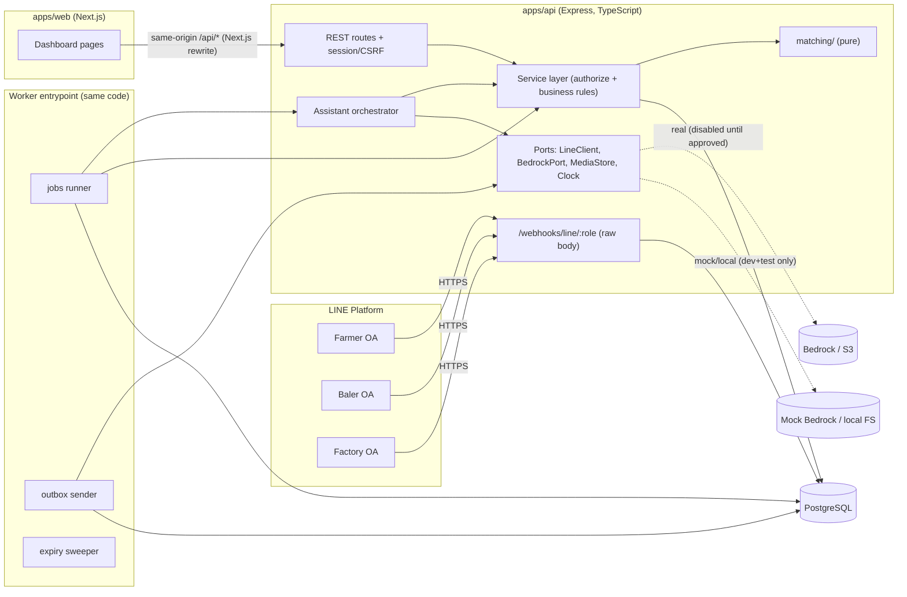
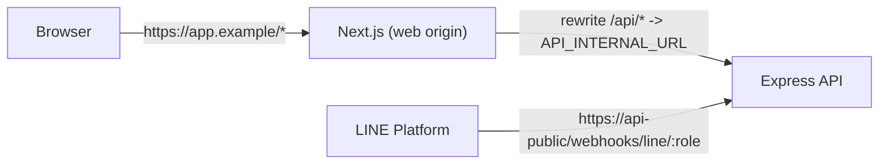
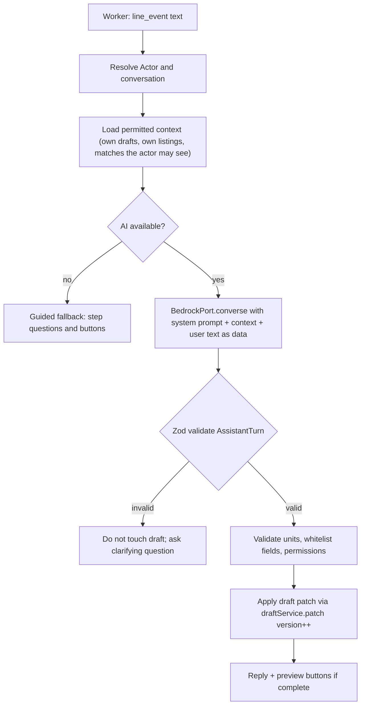
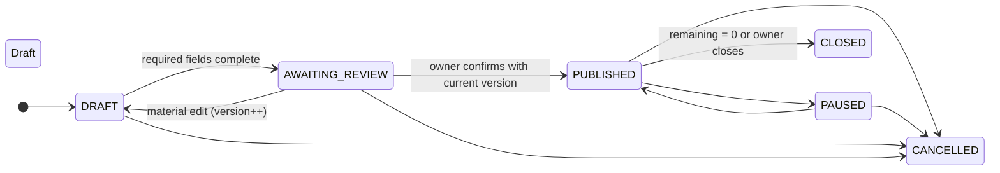
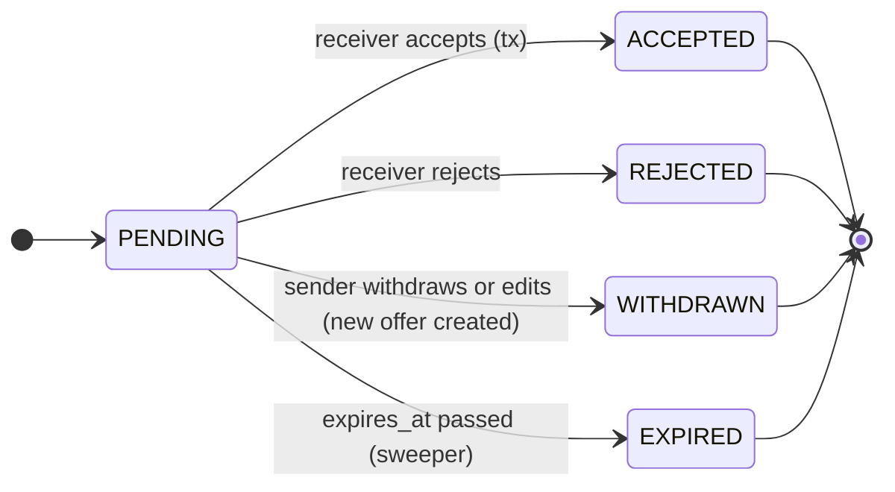
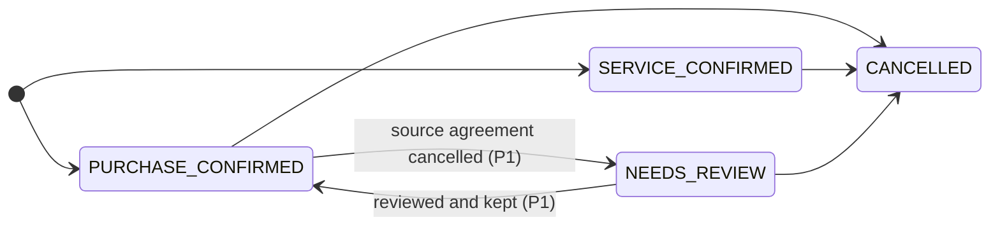
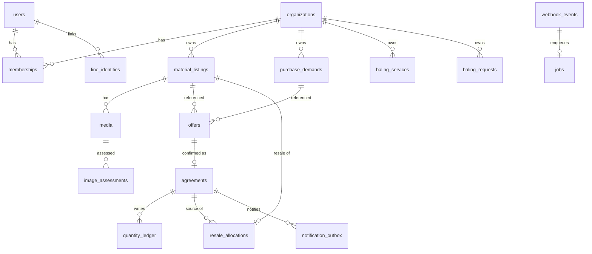

# Design Document: Agrimatch MVP

## Overview

Agrimatch connects farmers, balers (โรงงานอัด) and downstream buyer factories (โรงงานรับซื้อ) so that agricultural residue (rice straw, sugarcane leaves, corn cobs) can be listed, matched, offered and agreed in the system. This document turns `requirements.md` (Requirements 1-19, P0/P1/P2, blockers B1-B8, open questions 1-14) and `docs/AGRIMATCH_MVP_SPEC.md` into a buildable design. It also reads the four steering files (`product`, `tech`, `structure`, `aws`).

Design priorities, in order:

1. **Safety floor** (from requirements): Backend permission checks on every channel, human confirmation before publish and before any transaction, quantity control with idempotency, webhook signature verification, the image-assessment disclaimer, and never reporting a mock as a real integration.
2. **Story 1 first** (direct sale). Stories 2 (baling service) and 3 (resale) reuse the same services.
3. **Replaceable edges.** LINE, Bedrock and S3 sit behind ports. The core (matching, state machines, quantity ledger) is pure or database-only, so it is fully testable without real LINE or AWS.

Scope boundaries: no payments, escrow, transport or baling-job tracking, certified grades, live market prices or carbon credits (Requirement 19). `PURCHASE_CONFIRMED` and `SERVICE_CONFIRMED` are the terminal happy-path states.

## Confirmed by user (18 Nov 2026)

These are user decisions. They are no longer open questions.

- **A8 / Q1:** One acceptance by the receiver completes an offer. This simple rule applies to every offer kind, including BALER-initiated baling-service offers and offers that involve several farmers. There is no second confirmation.
- **A9 / Q2:** When the quantity is insufficient at accept time, the offer stays `PENDING` and accept returns `409 INSUFFICIENT_QUANTITY`.
- **A1 / Q5:** The 80 km transport cap is a hard exclusion filter for routes 1, 2 and 4. Distance is still scored.
- **Same-origin web and API:** see "Deployment topology and session cookie" below. The cross-site cookie caveat is removed.
- **LINE:** The user's LIFF setup is already done on their side. This design does not use LIFF (A2). The user will supply the three LINE OA channel secrets and tokens and a public HTTPS URL.
- **External services:** The user connects LINE, AWS/Bedrock, S3 and hosting later. The real adapters (LINE client with signature verification, Bedrock Converse, S3 store) are built behind the existing ports and stay disabled by `ENABLE_REAL_LINE`, `ENABLE_REAL_BEDROCK` and `ENABLE_REAL_S3` (default `false`). Development and tests use fakes and local Docker Postgres. This work creates and changes no AWS or LINE resource, and never reports an integration as working until the user has verified it. A final task writes `docs/HANDOVER.md`.

**Default applied, no answer from the user:** Q3 / A7 (a personal FARMER organization is created automatically on follow). Q4 (who approves and owns S3 and IAM): the user does not know, so the S3 bucket and IAM policy are written as CDK or CloudFormation files for the user to review and deploy. They are not deployed by this work. This is a hand-over item.

Q6 (privacy policy for stored conversation text) and Q7 (`packages/contracts`) are still open. Q7 defaults to a shared `packages/contracts` workspace.

## Design assumptions still pending user confirmation

The remaining rows are **design assumptions, not user decisions**. Rows A1, A7, A8 and A9 are marked with their status. Each can be changed with the stated blast radius. Any code built on them must keep the change local.

| # | Assumption | Source conflict / open question | If the user decides otherwise |
|---|---|---|---|
| A1 (confirmed) | The 80 km transport cap from `steering/product.md` is a **hard exclusion filter** for purchase and resale routes (1, 2, 4) when both sides have coordinates, **and** distance is still scored (30%). The cap is a config value `maxTransportKm=80`. Route 3 (baling) does not use the 80 km cap; it uses the service area of the Baling_Service. A buyer's own smaller `radius_km` also excludes. | Open question 1, Requirement 9.11 | Change one config value, or switch the filter to "flag only". Matching tests are parameterized by the cap. |
| A2 | `docs/AGRIMATCH_MVP_SPEC.md` is **primary** over steering where they conflict. Consequences: TypeScript matching (not Python `matching/`), no Redis/PostGIS (Haversine in code), LINE OA x3 plus Dashboard (no LIFF, no offline PWA required here), no F5 grouping, no farmer net-income model. The Bootcamp "F3-only" scope is not the scope of this spec. | Open questions 2-5, 9 | Steering files should be updated by the user. Nothing in this design depends on LIFF or PWA. |
| A3 | **No AWS resource is created or changed by this work.** S3 and Bedrock are adapters behind interfaces. A clearly marked local/mock implementation is for development and tests only and refuses to start when `NODE_ENV=production`. The real implementations (LINE client, Bedrock Converse, S3) are written but stay disabled (`ENABLE_REAL_LINE=false`, `ENABLE_REAL_S3=false`, `ENABLE_REAL_BEDROCK=false`) until the user supplies credentials and verifies them (blockers B1-B4). Confirmed by the user on 18 Nov 2026. | Open question 8, `aws.md` | Flip the flags after the user connects each service. The bucket and IAM policy are written as CDK/CloudFormation for the user to review and deploy; this work does not deploy them. |
| A4 | The Bedrock model ID is configuration. Default `anthropic.claude-sonnet-5`, region `ap-southeast-1`. Startup rejects IDs starting with `global.` or `apac.`. Image support of that model is **unverified**, so the vision adapter has its own setting `BEDROCK_VISION_MODEL_ID` and a feature flag `VISION_ENABLED=false`. Any "image unsupported" or access error maps to the status `UNAVAILABLE` ("assessment unavailable"), and the listing continues. | Open question 7, blocker B3 | If a second vision-capable model is needed, set one env var. |
| A5 | TypeScript everywhere: `apps/api` (Express), `apps/web` (Next.js App Router), small `packages/contracts` (shared Zod DTOs). PostgreSQL 16 with **node-pg-migrate** (plain SQL migrations) plus **`pg`** and hand-written typed repositories. Local Docker Postgres for dev and tests. Railway/Vercel are unconfirmed (B6). The matching engine is TypeScript with a versioned rule config and the spec's score formulas. Decimals use `decimal.js`. | Open question 2, blockers B5-B6 | See "Technology choices" for the justification and the cost of swapping. |
| A6 | The Python demo (`webapp.py`, `lot_planning.py`, `lot_service.py`, `lot_state.py`, `web/`) and `agent.py` stay **untouched**. Ideas reused only conceptually (see "Reused ideas"). | Requirements Introduction | None. |
| A7 (default applied) | Each farmer gets a personal organization of kind `FARMER` created when they follow the farmer OA. All ownership checks are then uniformly `org_id`-based. | Not in spec | Replace with user-owned rows; touches the permission layer only. |
| A8 (confirmed) | One acceptance by the **receiver** completes an offer (sender confirmed the terms by sending). This is the simple rule for purchase offers in both directions, baling-service offers (including BALER-initiated ones) and multi-farmer offers. | Open question 10 (closed) | The state machine is table-driven; adding a second confirmation is one new state. |
| A9 (confirmed) | If a receiver accepts an offer but the remaining quantity is no longer enough, the accept call fails with `409 INSUFFICIENT_QUANTITY` and the offer **stays `PENDING`**. The sender can withdraw and re-offer. | Requirement 12.7 wording | Auto-expire or auto-reject is a one-line change in the accept service. |
| A10 | Resale quantity is reserved on the source Agreement when the resale **draft** is created, and released when the draft or listing is discarded, closed or cancelled with unsold quantity. | Requirement 14.5 | Move reservation to publish time (risk: over-allocation across drafts). |
| A11 | Defaults for open question 13 (all in config, all changeable): image max 5 MB, types `image/jpeg` and `image/png`, presigned URL TTL 300 s, link code TTL 10 min, offer default expiry 72 h, quantity `numeric(14,3)`, price `numeric(12,4)`, money total `numeric(14,2)`, Bedrock text `maxTokens=1024`, timeout 20 s, 2 retries, history window 12 messages. Local units (เกวียน, ไร่) are not converted; the assistant must ask for kg or tons (Requirement 6.9). | Open questions 6, 13 | Config edits. |
| A12 | Rich menu and Flex Messages are P1. P0 uses text, quick reply and postback buttons. | Open question 14 | Cut order already defined. |

## Technology choices and justification

- **node-pg-migrate + `pg` + hand-written SQL repositories** instead of Prisma/Drizzle. The core guarantees (row locks with `SELECT ... FOR UPDATE`, `CHECK` constraints, partial unique indexes, `ON CONFLICT DO NOTHING`, `FOR UPDATE SKIP LOCKED`) are SQL features. Writing them as SQL keeps them visible and reviewable. `pg` returns `numeric` as strings, which keeps money and kilograms away from floating point. The cost is more boilerplate for simple CRUD; repositories stay small and Zod validates every row read at the boundary. Swapping to Kysely later would only touch repositories.
- **decimal.js** for kg and THB arithmetic, **Zod** for all boundary validation, **fast-check + Vitest** for tests, **Pino** for logging with redaction, **argon2** (argon2id) for password hashes, **@aws-sdk/client-bedrock-runtime** (Converse) and **@aws-sdk/client-s3** for the real adapters.
- **Single deployable API + a worker entrypoint** from the same code base (as the spec requires). No Redis, no queue broker: PostgreSQL `jobs` and `notification_outbox` tables with `SKIP LOCKED`.

## Reused ideas from the Python demo (conceptual only)

The notes below come from the function and class names and docstrings in `lot_planning.py`, `lot_service.py` and `lot_state.py`. No code is imported or edited.

| Python idea | Agrimatch counterpart |
|---|---|
| `Reason(code, message_th)` with a fixed `REASON_ORDER`; Thai text cites the numbers | Match `reasons[]` are `{code, params}` in a fixed order. A deterministic renderer produces Thai text. The AI may paraphrase but never invents reasons. |
| Ordered `Violation` list with `CHECK_ORDER` | The filter stage returns exclusion codes in a fixed order; tests assert order and completeness. |
| `LotView.revision` and `check_write_preconditions` (optimistic concurrency) | `version` on drafts, listings, demands and offers. Writes carry `expectedVersion`. A stale version gives `409 STALE_VERSION`. |
| Idempotent confirm | `accept offer` returns the existing Agreement on repeat. |
| Decimals as strings in JSON; half-up rounding helper | The API serializes decimals as strings; all rounding is `ROUND_HALF_UP`. |
| `Result(ok, http_status, body)` | A typed `Result<T, AppError>` returned by services, mapped to HTTP or LINE messages at the edge. |

## Architecture



### Module boundaries (`apps/api/src`)

Dependencies point downward only. A lint rule (`eslint-plugin-boundaries` or `dependency-cruiser`) enforces this.

```text
http/        Express routes, middleware (session, CSRF, raw-body webhook), DTO mapping
channels/    line/ (webhook, signature, postback codec, message builders), web/
assistant/   orchestrator, prompts, tool set (draft-only), output schemas
services/    one file per use case; every function takes (actor, input); authorize() first
matching/    PURE: types, filters, scoring, ranking, rules/*.ts, explain; no I/O, no Date.now()
domain/      PURE: units, money/decimal, state machines, quantity rules, permissions matrix
repos/       SQL repositories (pg), row Zod schemas, transaction helper
adapters/    bedrock/{real,mock}, media/{s3,local}, line/{http,fake}, clock
jobs/        runner, handlers, outbox sender, sweepers
config/      env parsing (Zod), startup guards (model-ID guard, production-mock guard)
```

Rules:

- `matching/` and `domain/` import nothing from `repos/`, `adapters/` or `http/`. This is what makes the property-based tests cheap.
- `services/` is the only layer that calls `authorize()` and opens transactions. Routes, the LINE channel and the assistant tools call services and never repos.
- Adapters expose a `kind: 'real' | 'mock'` field. `/healthz` and the acceptance report script print it, so a mock can never be reported as a real integration (Requirement 18.5).

### Deployment topology and session cookie (same-origin)

The browser only ever talks to the web origin. Next.js forwards API calls to Express, so the session cookie is first-party. No cross-site cookie setting, `SameSite=None` or shared registrable domain is needed.



- **Rewrite:** `apps/web/next.config` has `rewrites: [{ source: '/api/:path*', destination: `${API_INTERNAL_URL}/:path*` }]`. The Express routes in the REST table below are served under `/api` from the browser's point of view (`/api/auth/login` reaches `/auth/login`). `API_INTERNAL_URL` is server-side only.
- **Cookie:** `agrimatch_sid` is `HttpOnly; SameSite=Lax; Path=/`, and `Secure` when `NODE_ENV=production`. It is set by Express and passes through the rewrite on the web origin, so the browser stores it for the web origin only.
- **CSRF:** unchanged. State-changing routes need an `Origin` header equal to `WEB_ORIGIN` plus the `X-CSRF-Token` header from `GET /api/me`. The Next.js rewrite keeps the browser's `Origin` and `Cookie` headers. Express sets `trust proxy` so the forwarded protocol and host are read correctly.
- **Development:** Next.js runs on `http://localhost:3000`, Express on `http://localhost:4000`, and `API_INTERNAL_URL=http://localhost:4000`. The browser only uses `localhost:3000`. `Secure` is off because `NODE_ENV` is not `production`. `WEB_ORIGIN=http://localhost:3000`.
- **Production:** the web origin is one public HTTPS URL. The API can run on the same host or a private URL that only the web server reaches. `Secure` is on, and `WEB_ORIGIN` is that HTTPS URL.
- **LINE webhooks:** LINE calls the API at its own public HTTPS URL (`/webhooks/line/:role`), not through the web origin. These routes are exempt from the session and CSRF layers because they use the signature. If the user puts both behind one host, `/webhooks/*` can also be routed there directly. This is a hand-over item.
- **Why the rewrite and not a direct call:** a direct browser-to-API call from a different site would need `SameSite=None; Secure`, CORS with credentials and third-party-cookie handling that browsers increasingly block. The rewrite avoids all three.

### Repository layout (additions only; Python files untouched)

```text
apps/api/        Express API + worker entry (src/server.ts, src/worker.ts)
apps/web/        Next.js Dashboard
packages/contracts/  Zod DTOs shared by api and web (cut-able: web may import from api types if time is short)
db/migrations/   node-pg-migrate SQL files
db/seeds/        demo seed (is_demo = true on every row)
docker-compose.yml   postgres:16 for dev and tests
```

### Transaction and locking strategy (accept offer)

All transitions that change quantity run in one PostgreSQL transaction at `READ COMMITTED` with **explicit row locks**, plus constraints as a backstop.

```mermaid
sequenceDiagram
  participant C as Caller (LINE postback / Dashboard)
  participant S as acceptOffer service
  participant DB as PostgreSQL
  C->>S: acceptOffer(actor, offerId, idempotencyKey)
  S->>S: authorize(actor, offer.accept)
  S->>DB: BEGIN
  S->>DB: SELECT offer FOR UPDATE
  alt offer already ACCEPTED
    S->>DB: SELECT agreement WHERE offer_id
    S-->>C: existing Agreement (no writes)
  else PENDING
    S->>DB: lock listing and demand rows FOR UPDATE ordered by (table, id)
    S->>S: validate: not expired (DB now()), versions, remaining >= qty, min lot, receiver org
    S->>DB: INSERT agreement (UNIQUE offer_id)
    S->>DB: INSERT quantity_ledger rows (UNIQUE agreement,subject,kind)
    S->>DB: UPDATE listing/demand remaining and committed (CHECK total = committed + remaining)
    S->>DB: UPDATE offer ACCEPTED; close listing if remaining = 0
    S->>DB: INSERT notification_outbox rows (dedupe_key) and audit_logs
    S->>DB: COMMIT
    S-->>C: new Agreement
  end
```

Details:

- **Lock order.** Lock the offer, then supply and demand rows sorted by `(table_name, id)`. A fixed order prevents deadlocks between two accepts that touch the same rows in opposite order. On `40P01` (deadlock) or `40001` the service retries the whole transaction up to 3 times.
- **No reservation while `PENDING`** (Requirement 12.6). Two accepts on the same listing serialize on the listing row lock; the second one sees the reduced `remaining_qty_kg` and fails with `INSUFFICIENT_QUANTITY` (A9).
- **Baling offers** lock only the offer row, the Baling_Service and the Baling_Request rows for state checks, and **write no quantity** (Requirement 13.2).
- **Database backstops.** `CHECK (total_qty_kg = committed_qty_kg + remaining_qty_kg)`, `CHECK (remaining_qty_kg >= 0)`, `UNIQUE (offer_id)` on agreements, unique ledger rows. If application logic is wrong, the database refuses the write.
- **Idempotency layers.** (1) natural: `agreements.offer_id UNIQUE` and the offer status check; (2) API: `Idempotency-Key` header stored in `idempotency_keys(org_id, scope, key, request_hash, response)`; (3) LINE: the webhook event ID (`channel + eventId` unique) so a replayed postback does nothing.

## Components and Interfaces

### Actor and permission layer (Requirement 1)

```ts
type Role = 'FARMER' | 'BALER' | 'BUYER_FACTORY';
type Channel = 'line:farmer' | 'line:baler' | 'line:factory' | 'web' | 'assistant';
interface Actor { userId: string; orgId: string; role: Role; channel: Channel; }
```

- `Actor` is built only by trusted code: the LINE channel (from the verified channel plus `line_identities` row) or the session middleware (from the server-side session row). The client never supplies role or org (Requirement 1.7).
- `domain/permissions.ts` holds the capability matrix from spec section 4 as data: `Capability -> Role[]`. `authorize(actor, capability, resource?)` checks (a) the capability for the role, (b) `resource.orgId === actor.orgId` (ownership) or an explicit counterparty rule (the offer receiver may read and accept; a matched party may read published fields).
- **Every service function takes `actor` as its first parameter and calls `authorize` before any read or write.** A test enumerates the service registry and fails if a registered service has no capability declared. The assistant tools call the same services with the same actor, so AI and humans share one permission path.
- Cross-org reads return `404 NOT_FOUND` (not 403) so existence is not leaked (Requirement 1.4). Role violations return 403.
- A user with several memberships: the web session has one `active_org_id`; each LINE channel resolves to the linked org whose `kind` matches the channel (Requirement 1.6).

### LINE gateway (Requirement 2)

Routes: `POST /webhooks/line/farmer|baler|factory`. Each route maps to a config entry `{channelKey, channelSecret, accessToken}`.

Handling order (all inside one request, no Bedrock call):

1. A router-level `express.raw({ type: '*/*', limit: '1mb' })` is mounted for `/webhooks/line/*` **before** `express.json()`, so the body is a `Buffer`.
2. `verifySignature(rawBody, header, secret)`: HMAC-SHA256, base64, compared with `crypto.timingSafeEqual` after a length check. Missing or wrong signature gives `401`, with no parse, no insert, no log of the body (Requirement 2.2, 2.3).
3. Parse JSON with Zod (`events[]`). Invalid shape gives `400` after a valid signature.
4. In one transaction, for each event: `INSERT INTO webhook_events (channel, event_id, payload) ... ON CONFLICT (channel, event_id) DO NOTHING RETURNING id`; if a row was inserted, `INSERT INTO jobs (kind='line_event', payload={webhookEventId}, dedupe_key=channel||':'||event_id)`. Then `COMMIT` and reply `200`. Duplicates return `200` with no new job (Requirement 2.5). LINE verification requests with empty `events` also return `200`.
5. The worker picks up `line_event` jobs, resolves the identity, and runs the per-role handler.

Per-role handlers (`channels/line/handlers/{farmer,baler,factory}.ts`) share one pipeline and differ only by the role passed into `resolveActor` and by the menu and postback allow-list:

| Event | Behaviour |
|---|---|
| `follow` (farmer OA) | Create or find `line_identities(channel, line_user_id)`, create personal FARMER org + user if new (A7), send greeting + quick replies. |
| `follow` (baler/factory OA) | Create an `UNLINKED` identity. Only the link-code prompt is allowed (Requirement 1.5). |
| `message.text` | If the text matches a link code pattern, try linking (Requirement 3.2). Else if linked, enqueue assistant turn. If unlinked, repeat the link prompt. |
| `message.image` | Job downloads content with the channel token, validates and stores (see Media), attaches to the active draft. |
| `message.location` | Stored as user-provided coordinates on the active draft (never derived from a province name; Requirement 6.6). |
| `postback` | Decode `action=...&id=...&v=...` with the postback codec, then call the corresponding service with the actor. Allowed actions per role are a static table. |

`LineClient` has two implementations: `HttpLineClient` (real, calls the LINE Messaging API with the channel token) and `FakeLineClient` (records sends). Wiring picks the real one only when `ENABLE_REAL_LINE=true` and all three channel secrets and tokens are present. Otherwise the fake is used and `/healthz` shows `line: mock`. Signature verification is pure and is always active, because it needs only the secret. With the real flag off, webhook tests sign payloads with a test secret.

Output: all replies and pushes go through `LineClient.forChannel(channelKey)`, which owns that channel's access token (Requirement 2.8). The outbox row stores the channel key, and the sender cannot choose a token any other way. Retries use the LINE retry key (`X-Line-Retry-Key`) stored in `notification_outbox.retry_key`, so retrying a push does not deliver twice.

Postback codec: `encodePostback({action, id, version?})` and `decodePostback(string)` with Zod; data is limited to LINE's postback size; unknown actions are rejected. Postback data is not trusted for authority: the service still authorizes the actor.

### Auth, sessions, CSRF, link codes (Requirement 3)

- **Login:** `POST /auth/login {email, password}`. Argon2id verify (a constant dummy verify when the email is unknown, to reduce user enumeration by timing). Login attempts are rate limited per IP+email (in-memory limiter for MVP, noted as single-instance only). Session is a random 256-bit token; the DB stores only `sha256(token)` in `sessions`. Cookie `agrimatch_sid`: `HttpOnly; Secure; SameSite=Lax; Path=/`, idle and absolute expiry from config.
- **CSRF:** every state-changing route requires (a) an allowed `Origin` header and (b) header `X-CSRF-Token` equal to the per-session `csrf_secret` returned by `GET /me`. Webhook routes are exempt because they use the signature. Because the browser only talks to the web origin (see "Deployment topology and session cookie"), the cookie is first-party and needs no cross-site configuration. The `Origin` check allows only the configured web origin (`WEB_ORIGIN`).
- **Link codes:** `POST /line-link-codes {channel}` by a logged-in member. The code is 8 characters from an unambiguous alphabet, stored only as a hash with `expires_at`, `org_id`, `user_id`, `channel`, `used_at`. Redeeming runs in one transaction: `UPDATE ... SET used_at = now() WHERE code_hash = $1 AND used_at IS NULL AND expires_at > now() AND channel = $2 RETURNING ...` and, if a row returns, sets the `line_identities` row to `LINKED`. Wrong channel, expired, used and unknown codes all give the same generic Thai failure message (Requirement 3.3). Knowing an org name or email never grants membership (Requirement 3.4). Codes and passwords are never logged; Pino `redact` paths cover them.

### Assistant orchestrator (Requirement 4, 5)



- **Tool set is closed and draft-only:** `patch_draft`, `ask_user`, `explain_matches`, `show_status`, `answer_general`. There is **no** tool that publishes, sends an offer, accepts, confirms or cancels. Those actions exist only as postbacks from a button that the system rendered, executed by services with the human's actor (Requirement 5.1, spec 8.3).
- **Output schema** (`AssistantTurnSchema`): `{ intent: enum, reply_text: string(<=1000), draft_patch?: object, questions?: string[] }`. `draft_patch` is validated against a per-draft-kind whitelist schema. Fields that never come from the model: `status`, `version`, `org_id`, `published_*`, `source_agreement_id`, any price on someone else's behalf. Unknown keys are dropped by `.strict()` rejection, not silently kept.
- **Units and ambiguity:** quantity patches carry `{value, unit}` with unit in `kg|ton`. Any other unit (เกวียน, ไร่, "bales") leads to a clarifying question and no write (Requirement 4.6, 6.9). Dates must be ISO or relative phrases the orchestrator resolves with the injected `Clock` in `Asia/Bangkok`; ambiguity leads to a question.
- **Baler ambiguity:** for BALER, `intent` must be resolved to `BALING_SERVICE` or `PURCHASE_DEMAND` before a draft of either kind is created; otherwise the assistant asks (Requirement 4.7).
- **Prompt injection:** the system prompt states rules and the output schema. User text, image-derived text and conversation history are placed only in `user` turns inside delimiters, and never concatenated into the system prompt. The model output has **no authority**: every effect passes Zod, the whitelist, the unit check and the service-layer permission check. Context loading is by actor, so the model cannot see other orgs' data even if told to ask for it. Match explanations are rendered from `reasons[]` supplied by the backend; the assistant's text is advisory and the card with numbers is rendered by the backend, not by the model (Requirement 4.8).
- **Degraded mode (Requirement 4.11):** if `AI_MODE=disabled`, or Bedrock fails after retries or times out, the orchestrator switches the conversation to a **step form**: a fixed question list per draft kind (field order, quick replies for enums, free text parsed by deterministic parsers for numbers like "5 ตัน"). The Dashboard forms are always available. Matching, offers and agreements never call the AI.
- **History:** the last N messages (config) are sent. Summarization is P1 (Requirement 4.12).

### Bedrock adapter (Requirement 4)

```ts
interface BedrockPort {
  readonly kind: 'real' | 'mock';
  converse(req: ConverseRequest, signal: AbortSignal): Promise<ConverseResult>; // text or text+image
}
type ConverseResult =
  | { ok: true; text: string; usage: { inputTokens: number; outputTokens: number }; modelId: string }
  | { ok: false; code: 'TIMEOUT' | 'THROTTLED' | 'ACCESS_DENIED' | 'MODEL_UNSUPPORTED' | 'INVALID_REQUEST' | 'UPSTREAM_5XX'; retryable: boolean };
```

- **Real adapter** uses `ConverseCommand` from `@aws-sdk/client-bedrock-runtime` in `ap-southeast-1`, with `inferenceConfig.maxTokens` from config on every call, SDK `maxAttempts=1`, and its own retry loop (max 2 retries, exponential backoff with jitter) only for `TIMEOUT`, `THROTTLED` and `UPSTREAM_5XX`. Each call has an `AbortSignal` timeout. `ACCESS_DENIED` and `MODEL_UNSUPPORTED` never retry.
- **Structured output without assuming tool-use support:** the prompt asks for a single JSON object; the orchestrator extracts and Zod-validates it; one repair retry is allowed with the validation error text (not the user's raw text); then the turn fails closed to a clarifying question.
- **Config guard** (`config/guards.ts`) runs at process start: it rejects any model ID (text or vision) starting with `global.` or `apac.`, rejects regions outside an allow-list (`ap-southeast-1` default; `ap-southeast-7` and `us-east-1` allowed by the team account but unused), and refuses the mock adapter when `NODE_ENV=production`. The error message names the offending value.
- **Mock adapter** (`adapters/bedrock/mock.ts`, under a `test-support` export, never imported by production wiring) returns scripted responses for tests and UI development. Its `kind` is `'mock'`.
- **Enabling the real adapter** needs `ENABLE_REAL_BEDROCK=true`, which is off by default and must not be turned on until the user approves the model check (A3). `check_bedrock.py` or the AWS MCP server remains the way to verify access; this work does not run AWS calls.

### Image upload and assessment (Requirement 8)

```mermaid
sequenceDiagram
  participant U as User (LINE image / Dashboard upload)
  participant API as API or Worker
  participant MS as MediaStore port
  participant DB as PostgreSQL
  participant V as Image_Assessor (BedrockPort vision)
  U->>API: image bytes
  API->>API: authorize(actor owns target draft/listing); size <= max; sniff magic bytes (jpeg/png)
  API->>MS: put(key = media/{orgId}/{uuid}) private
  API->>DB: INSERT media; INSERT job assess_image (dedupe_key = media_id)
  API-->>U: accepted (listing can publish now; assessment is optional)
  V->>MS: get bytes
  V->>V: converse(vision model, strict JSON schema)
  V->>DB: INSERT image_assessments {status, result, model_id, assessed_at}
```

- `MediaStore` port: `put`, `get`, `presignGet(key, ttl)`, `delete`, plus `kind`. `S3MediaStore` is the real one (private bucket, server-side encryption, presigned GET with TTL from config, no public ACL, IAM role or temporary credentials, never keys in code). `LocalFsMediaStore` writes under a git-ignored directory, returns app-signed short-lived URLs verified by the API, and refuses `NODE_ENV=production`.
- **URL issuance** is a service call: `getMediaUrl(actor, mediaId)` authorizes first, then presigns. Storage keys are never returned to clients.
- **Validation:** content type by magic bytes (not the client's header), size limit, no original filename in the key, and `sha256` stored for deduplication.
- **Assessment result schema:** `{ likely_material, color, surface_condition, visible_contaminants[], limitations[], follow_up_questions[] }`. The schema has **no** field for moisture percent, heating value, grade or standard compliance, and the prompt forbids them; a post-validator rejects results whose text matches percent/grade/standard patterns (`/%|เกรด|มาตรฐาน|kcal|MJ/`) and stores `UNASSESSABLE` or strips the offending field.
- **Statuses:** `OK`, `UNASSESSABLE` (image not suitable), `UNAVAILABLE` (flag off, model unsupported, access denied, budget), `FAILED` (transient, after retries). Every status lets the listing publish and match on owner-confirmed data (Requirement 8.8).
- **Disclaimer:** the API returns `disclaimer_th: "การประเมินเบื้องต้นจากภาพ ไม่ใช่ผลตรวจคุณภาพจริง"` as a constant field in every payload that carries an assessment. Web and LINE renderers must show it; a component test and a message-builder test enforce this (Requirement 8.6).
- **No reuse:** assessments are keyed by `media_id`. The resale draft copies no assessment as post-baling quality; if it shows a pre-baling image it must show `source` and `assessed_at` (Requirement 14.8).
- **P0 cut:** only the farmer OA image path is built first (cut order item 2).

### Matching engine (Requirements 9, 10, 7.7, 14.10)

A pure module. Input: normalized subjects and a `RuleConfig`. Output: ranked `MatchResult[]`. No clock reads (the caller passes `now`), no randomness, no I/O.

```ts
type Route = 1 | 2 | 3 | 4;
interface RuleConfig { version: string; maxTransportKm: number; trade: Weights5; service: Weights5; }
interface MatchResult {
  route: Route; supplyId: string; demandId: string; ruleVersion: string;
  excluded?: ExclusionCode[];            // present only from filterOnly(); engine output omits excluded pairs
  score: string;                         // decimal string 0-100, 2 dp
  components: Record<ComponentKey, { value: string | null; weight: string }>; // null = unknown
  weightCoverage: string;                // sum of weights of known components, 0-1
  flags: Flag[];                         // NEEDS_CONFIRMATION(field), INCOMPLETE, PRICE_MISMATCH, DISTANCE_UNVERIFIED
  distanceKm: string | null; distanceKind: 'straight_line' | null;
  reasons: Reason[];                     // {code, params}, fixed order
  tier: 0 | 1;                           // 0 = all mandatory confirmed and coverage 1
}
```

**Routes.** (1) Listing (SALE, farmer) with Demand (BUYER_FACTORY). (2) Listing (SALE, farmer) with Demand (BALER). (3) Baling_Request with Baling_Service. (4) Listing (RESALE, BALER) with Demand (BUYER_FACTORY). Route is a function of the owner roles and `listing.kind`; a pair with the same `org_id` is excluded (Requirement 9.5).

**Filter stage** (ordered exclusion codes, constant order): `NOT_PUBLISHED`, `NO_REMAINING`, `SAME_ORG`, `MATERIAL_MISMATCH` (including `OTHER` unconfirmed material), `FORM_MISMATCH`, `BELOW_MIN_LOT`, `WINDOW_NO_OVERLAP`, `AREA_MISMATCH`, `OVER_RADIUS` (buyer radius), `OVER_MAX_TRANSPORT` (A1, cap 80 km, routes 1, 2, 4 only). A check whose input is missing does not exclude; it yields a `NEEDS_CONFIRMATION(field)` flag and tier 1 (Requirement 9.6). Without coordinates on either side the distance is `null`, the flag `DISTANCE_UNVERIFIED` is set, and no radius claim is made (Requirement 9.8).

**Scoring** (components in [0,1], computed with `decimal.js` precision 28, rounded half-up to 4 dp per component and to 2 dp for the total, so results are bit-for-bit repeatable):

| Component (trade) | Weight | Formula |
|---|---|---|
| distance | 0.30 | `1 - d / cap` where `cap = min(maxTransportKm, demand.radius_km ?? maxTransportKm)`; unknown if `d` is null |
| quantity | 0.25 | `min(L, D) / L` where L = listing remaining, D = demand remaining (share of the seller's lot this buyer can absorb) |
| price | 0.20 | both prices known and in THB/kg after unit normalization: `1` if ask <= max else `max(0, 1 - (ask - max)/max)`; unknown if either is `NEGOTIABLE`, missing, or units are not convertible (Requirement 10.8) |
| time | 0.15 | overlap days / shorter window length (min 1 day); unknown if a window is missing |
| conditions | 0.10 | known checks only: transport responsibility compatible, moisture declared <= buyer max, pending-material acceptance (resale); `pass / (pass + fail)`; unknown if no check is decidable |

| Component (baling, route 3) | Weight | Formula |
|---|---|---|
| service area | 0.35 | coordinates and service radius: `1 - d / radius`; province list: 1 if member; unknown otherwise |
| material and form | 0.25 | fraction of preferences satisfied (mode on-site/off-site, bale format) given material already equal |
| time | 0.20 | as above |
| quantity | 0.10 | `min(1, capacity / R)` when capacity is known; unknown otherwise |
| price | 0.10 | request budget vs service price when both are THB/kg or THB/ton; unknown for per-bale or negotiable |

`total = 100 * sum(w_i * v_i over known) / sum(w_i over known)`. If no component is known the match is kept with score `0` and `INCOMPLETE`, tier 1. `weightCoverage = sum(w_i over known)` is stored and shown (Requirement 10.4). The weights are demo defaults and the UI says so (Requirement 10.7).

**Ranking:** sort by `(tier asc, score desc, stableId asc)`. Tier 1 pairs never rank above tier 0 pairs for the same subject (Requirement 10.5). `stableId` is `supplyId + demandId`, so equal scores order deterministically.

**Rule config:** `matching/rules/v1.ts` exports a frozen object validated with Zod at startup (weights are non-negative and each group sums to 1; `maxTransportKm > 0`). `version` is a string such as `rules-2026-11-18.1`. Changing a weight means a new file and a new version; old `matches` rows keep their version.

**Explanations:** `reasons[]` entries are `{code, params}` in a fixed order (for example `DISTANCE_KM`, `QTY_COVERAGE`, `PRICE_WITHIN_BUDGET`, `PRICE_ABOVE_BUDGET`, `WINDOW_OVERLAP_DAYS`, `MISSING_<FIELD>`). `explain.th.ts` renders Thai text citing the numbers. Distance text always says "ระยะเส้นตรง" (Requirement 9.7). The assistant receives these, never invents others.

**Persistence and recompute:** the API calls `matching.run(...)` after publish or change of a listing, demand, service or request, via a `recompute_matches` job (Requirement 7.7). The job loads candidates with SQL pre-filters (status, material, remaining > 0) and calls the pure engine, then upserts into `matches` keyed `(route, supply_id, demand_id, rule_version)` and deletes rows for pairs that no longer pass. Rows carry `supply_version` and `demand_version`; a match whose source version is older than the current row is treated as stale and hidden until recomputed.

**Visibility:** `GET /matches` returns only the actor's own side and only published fields of the counterparty. Contact data, exact addresses of private listings and the farmer's identity are not in the payload (Requirement 9.10, 14.9, 17.5).

### Offers, agreements and state machines (Requirements 11-14)







- Transition functions live in `domain/state/*.ts` as pure tables `next(state, event) -> state | Error`. Services call them; the DB `CHECK (status IN (...))` is the backstop. There is no `DELIVERED`, `PAID` or `COMPLETED` state anywhere (Requirements 12.10, 13.4, 19.4).
- **Offer edit** = `withdraw(old)` + `create(new)` in one transaction; an `ACCEPTED` offer cannot be changed (Requirement 11.6).
- **Offer creation** snapshots `listing_version` and `demand_version`; accept compares them to current rows and fails with `409 STALE_VERSION` if terms-relevant fields changed (Requirement 12.3).
- **Transport cost** is stored in its own nullable column `transport_cost_thb` and is never added into `total_amount_thb` (Requirement 11.2).
- **Resale offers** carry `pending_material_ack` and the expected-ready date. The buyer's offer or acceptance must include `ack_pending_material=true` when the resale listing is flagged `pending_material` (Requirement 14.11).

### Resale allocation rules (Requirement 14)

1. Only an actor of role BALER whose org is `buyer_org` of a `PURCHASE_CONFIRMED` agreement can create a resale draft from it (403 otherwise; Requirement 14.4). The call creates a `drafts` row of kind `RESALE_LISTING` with `source_agreement_id`, material and the default quantity, and **does not publish** (Requirement 14.2).
2. At draft creation or quantity edit, in one transaction: lock the source agreement row, compute `reserved = resale_reserved_kg + requested`, require `reserved <= agreement.qty_kg`, update `resale_reserved_kg`, upsert `resale_allocations(source_agreement_id, draft/listing, qty_kg, ACTIVE)` (A10, Requirement 14.5). `CHECK (resale_reserved_kg BETWEEN 0 AND qty_kg)` is the backstop.
3. While material is not received or baled, `pending_material=true` and `expected_ready_at` are required for publish (Requirement 14.6). No automatic "received" or "baled" status is ever set (Requirement 14.7).
4. The resale listing stores its own location, separate from the source listing's location, and copies no farmer contact data (Requirement 14.9).
5. On publish, matching route 4 runs (Requirement 14.10). A downstream accept creates a new `PURCHASE` agreement with `source_agreement_id` pointing upstream and decrements the resale listing and the buyer's demand exactly like Story 1.
6. On draft discard, listing cancel or close with unsold quantity, the allocation is reduced to the sold amount and the difference is released from `resale_reserved_kg` (transactionally).
7. P1: cancelling a source agreement pauses dependent resale listings, marks downstream agreements `NEEDS_REVIEW` and queues notifications (Requirement 14.13); nothing is deleted.

### Notification outbox and jobs (Requirements 2.9, 15)

- `jobs` and `notification_outbox` use the same pattern: `SELECT ... WHERE status IN ('QUEUED','RETRY') AND run_at <= now() ORDER BY run_at FOR UPDATE SKIP LOCKED LIMIT n`, a lease (`locked_until`) so a crashed worker's rows are retaken after restart, `attempts`, `max_attempts` (config), exponential backoff with jitter, terminal `DEAD`.
- Outbox rows are inserted inside the business transaction (accept, offer create, reject, expire). The sender never modifies offers or agreements (Requirement 15.3). A permanent failure sets `DEAD`; the Agreement remains readable through the Dashboard and LINE menu (Requirement 15.4).
- `dedupe_key` (for example `agreement:{id}:created:{recipient}`) is unique, so repeated inserts and repeated sends of a `SENT` row do nothing (Requirement 15.5). LINE rate limits or HTTP 429 reschedule with `Retry-After`.
- Sweepers: `expire_offers` every minute (`UPDATE offers SET status='EXPIRED' WHERE status='PENDING' AND expires_at <= now() RETURNING ...` plus outbox rows).

### REST API (spec section 14)

All routes sit behind session middleware and CSRF for state-changing methods, except `/webhooks/*` (signature) and `/auth/login`. Bodies are Zod-validated, decimals are strings, times are ISO UTC. Errors use `{ error: { code, message_th, details? } }`.

| Group | Endpoints | Notes |
|---|---|---|
| Auth | `POST /auth/login`, `POST /auth/logout`, `GET /me`, `POST /line-link-codes` | `/me` returns active org, role, csrf token |
| LINE | `POST /webhooks/line/:role` | raw body, signature, dedup |
| Assistant | `POST /assistant/messages` (P1 on Dashboard) | actor from session only |
| Drafts | `GET/POST /drafts`, `PATCH /drafts/:id` (expectedVersion), `POST /drafts/:id/publish` (expectedVersion, Idempotency-Key) | publish is the only way to create listings, demands and services from a draft |
| Listings | `GET /listings`, `GET /listings/:id`, `POST /listings/:id/pause|close` | owner checks |
| Demands | `GET/POST/PATCH /purchase-demands`, `POST .../open|close` | BALER or BUYER_FACTORY |
| Baling | `GET/POST /baling-services`, `GET/POST /baling-requests` | kept separate from demands |
| Matching | `GET /matches?subjectType&subjectId` | actor side only |
| Offers | `POST /offers`, `GET /offers`, `POST /offers/:id/accept|reject|withdraw` | accept uses the locked transaction |
| Agreements | `GET /agreements`, `GET /agreements/:id`, `POST /agreements/:id/resale-draft` | resale-draft only for the BALER buyer |
| Media | `POST /media` (multipart, limit), `GET /media/:id/url`, `GET /media/:id/assessment` | URL after authorize |
| Health | `GET /healthz` | prints adapter `kind` values, no secrets |

### Dashboard (Requirement 16)

Next.js App Router, server components fetch from the API with the user's cookie, Tailwind, mobile-first at 360 px (no horizontal scroll for main content; tables become card lists). All times formatted with `Intl.DateTimeFormat('th-TH', {timeZone: 'Asia/Bangkok'})`. Every estimate or score carries a label "ประมาณการ" or "ค่าเริ่มต้นสำหรับเดโม", and the AI estimates are visually separate from buyer-quoted prices (Requirement 19.2).

| Page | Roles | Priority |
|---|---|---|
| `/login` | all | P0 |
| `/demands`, `/demands/new`, `/demands/[id]` | BALER, BUYER_FACTORY | P0 |
| `/services` (baling services) | BALER | P0 |
| `/matches`, `/matches/[id]` (components, reasons, missing data) | BALER, BUYER_FACTORY | P0 |
| `/offers`, `/offers/[id]` (send, accept, reject, history) | both | P0 |
| `/agreements`, `/agreements/[id]` (with the "not payment/delivery/quality" notice) | both | P0 |
| `/resale`, `/resale/[draftId]` | BALER | P0 |
| `/settings/line` (generate link code) | both | P0 |
| `/` overview, `/settings/org`, `/settings/members`, `/assistant` | both | P1 |
| map, filters, stats | both | P2 |

## Data Models

PostgreSQL 16. Conventions: `uuid` primary keys (`gen_random_uuid()`), `timestamptz` UTC, `text` + `CHECK` for enums (easier to migrate than PG enums), `is_demo boolean` on seedable tables, `version int NOT NULL DEFAULT 1` on mutable business rows. Quantity `numeric(14,3)` kg, unit price `numeric(12,4)` THB per `price_unit`, money total `numeric(14,2)` THB, coordinates `numeric(9,6)`. No `float`/`real`/`double precision` columns for these values.



### Core DDL (abridged; constraints are the point)

```sql
CREATE TABLE organizations (
  id uuid PRIMARY KEY DEFAULT gen_random_uuid(),
  kind text NOT NULL CHECK (kind IN ('FARMER','BALER','BUYER_FACTORY')),
  name text NOT NULL, province text, district text,
  lat numeric(9,6), lng numeric(9,6),
  is_demo boolean NOT NULL DEFAULT false,
  CHECK ((lat IS NULL) = (lng IS NULL))
);

CREATE TABLE line_identities (
  id uuid PRIMARY KEY DEFAULT gen_random_uuid(),
  channel text NOT NULL CHECK (channel IN ('farmer','baler','factory')),
  line_provider_id text, line_user_id text NOT NULL,
  user_id uuid REFERENCES users(id), org_id uuid REFERENCES organizations(id),
  status text NOT NULL CHECK (status IN ('UNLINKED','LINKED')),
  UNIQUE (channel, line_user_id),
  CHECK ((status = 'LINKED') = (org_id IS NOT NULL AND user_id IS NOT NULL))
);

CREATE TABLE material_listings (
  id uuid PRIMARY KEY DEFAULT gen_random_uuid(),
  org_id uuid NOT NULL REFERENCES organizations(id),
  kind text NOT NULL CHECK (kind IN ('SALE','RESALE')),
  material_type text NOT NULL CHECK (material_type IN ('RICE_STRAW','CANE_LEAF','CORN_COB','OTHER')),
  material_form text CHECK (material_form IN ('LOOSE','BALED')),
  total_qty_kg numeric(14,3) NOT NULL CHECK (total_qty_kg > 0),
  committed_qty_kg numeric(14,3) NOT NULL DEFAULT 0 CHECK (committed_qty_kg >= 0),
  remaining_qty_kg numeric(14,3) NOT NULL CHECK (remaining_qty_kg >= 0),
  price_mode text NOT NULL CHECK (price_mode IN ('FIXED','NEGOTIABLE')),
  unit_price_thb numeric(12,4) CHECK (unit_price_thb IS NULL OR unit_price_thb >= 0),
  price_unit text CHECK (price_unit IN ('KG','TON')),
  province text, district text, lat numeric(9,6), lng numeric(9,6),
  available_from timestamptz, available_to timestamptz,
  transport_by text NOT NULL DEFAULT 'UNKNOWN' CHECK (transport_by IN ('SELLER','BUYER','EITHER','UNKNOWN')),
  pending_material boolean NOT NULL DEFAULT false, expected_ready_at timestamptz,
  source_agreement_id uuid REFERENCES agreements(id),
  source_draft_id uuid UNIQUE,                       -- publish idempotency
  status text NOT NULL CHECK (status IN ('PUBLISHED','PAUSED','CLOSED','CANCELLED')),
  version int NOT NULL DEFAULT 1, is_demo boolean NOT NULL DEFAULT false,
  CONSTRAINT qty_balance CHECK (total_qty_kg = committed_qty_kg + remaining_qty_kg),
  CONSTRAINT price_shape CHECK ((price_mode='FIXED' AND unit_price_thb IS NOT NULL AND price_unit IS NOT NULL)
                             OR (price_mode='NEGOTIABLE' AND unit_price_thb IS NULL)),
  CONSTRAINT resale_has_source CHECK (kind <> 'RESALE' OR source_agreement_id IS NOT NULL),
  CONSTRAINT pending_has_date CHECK (NOT pending_material OR expected_ready_at IS NOT NULL),
  CHECK ((lat IS NULL) = (lng IS NULL))
);
```

`NEGOTIABLE` stores `NULL`, never `0` (Requirement 6.5). The `OTHER` material type is stored but excluded from matching until the owner confirms a concrete type (Requirement 6.7).

`purchase_demands` mirrors this: `target_qty_kg`, `committed_qty_kg`, `remaining_qty_kg` with the same balance check, `min_lot_kg`, `max_unit_price_thb` nullable plus `price_mode`, `price_unit`, `accepted_materials text[]`, `accepted_forms text[]`, pickup `province/lat/lng`, `radius_km numeric(6,2)`, `accepted_provinces text[]`, `window_from/window_to`, `quality jsonb` (for example `max_moisture_pct`), `transport_by`, `accepts_pending_material boolean`, `status`, `version`. `baling_services` and `baling_requests` hold the fields in spec 7.3 with `status` and `version`; the service has optional `capacity_kg`.

```sql
CREATE TABLE offers (
  id uuid PRIMARY KEY DEFAULT gen_random_uuid(),
  kind text NOT NULL CHECK (kind IN ('PURCHASE','BALING_SERVICE')),
  from_org_id uuid NOT NULL REFERENCES organizations(id),
  to_org_id uuid NOT NULL REFERENCES organizations(id),
  listing_id uuid REFERENCES material_listings(id), demand_id uuid REFERENCES purchase_demands(id),
  baling_service_id uuid REFERENCES baling_services(id), baling_request_id uuid REFERENCES baling_requests(id),
  qty_kg numeric(14,3) NOT NULL CHECK (qty_kg > 0),
  unit_price_thb numeric(12,4), price_unit text, total_amount_thb numeric(14,2),
  transport_by text NOT NULL, transport_cost_thb numeric(12,2),       -- never folded into total
  ready_date date, expires_at timestamptz NOT NULL,
  listing_version int, demand_version int,                             -- snapshots for stale check
  ack_pending_material boolean NOT NULL DEFAULT false,
  status text NOT NULL CHECK (status IN ('PENDING','ACCEPTED','REJECTED','WITHDRAWN','EXPIRED')),
  supersedes_offer_id uuid REFERENCES offers(id),
  idempotency_key text, version int NOT NULL DEFAULT 1,
  UNIQUE (from_org_id, idempotency_key),
  CHECK (from_org_id <> to_org_id),
  CHECK ((kind='PURCHASE' AND listing_id IS NOT NULL AND demand_id IS NOT NULL)
      OR (kind='BALING_SERVICE' AND baling_service_id IS NOT NULL AND baling_request_id IS NOT NULL))
);

CREATE TABLE agreements (
  id uuid PRIMARY KEY DEFAULT gen_random_uuid(),
  kind text NOT NULL CHECK (kind IN ('PURCHASE','BALING_SERVICE')),
  offer_id uuid NOT NULL UNIQUE REFERENCES offers(id),             -- idempotent accept
  seller_org_id uuid NOT NULL, buyer_org_id uuid NOT NULL,
  listing_id uuid, demand_id uuid, baling_service_id uuid, baling_request_id uuid,
  qty_kg numeric(14,3) NOT NULL CHECK (qty_kg > 0),
  unit_price_thb numeric(12,4), price_unit text, total_amount_thb numeric(14,2),
  status text NOT NULL CHECK (status IN ('PURCHASE_CONFIRMED','SERVICE_CONFIRMED','NEEDS_REVIEW','CANCELLED')),
  resale_reserved_kg numeric(14,3) NOT NULL DEFAULT 0,
  source_agreement_id uuid REFERENCES agreements(id),
  version int NOT NULL DEFAULT 1, confirmed_at timestamptz NOT NULL DEFAULT now(),
  CONSTRAINT resale_cap CHECK (resale_reserved_kg >= 0 AND resale_reserved_kg <= qty_kg),
  CONSTRAINT kind_status CHECK (
    (kind = 'PURCHASE' AND status IN ('PURCHASE_CONFIRMED','NEEDS_REVIEW','CANCELLED'))
 OR (kind = 'BALING_SERVICE' AND status IN ('SERVICE_CONFIRMED','CANCELLED')))
);

CREATE TABLE quantity_ledger (                         -- append-only audit of every quantity change
  id bigserial PRIMARY KEY,
  subject_type text NOT NULL CHECK (subject_type IN ('LISTING','DEMAND')),
  subject_id uuid NOT NULL, agreement_id uuid NOT NULL REFERENCES agreements(id),
  entry_kind text NOT NULL CHECK (entry_kind IN ('COMMIT','RELEASE')),
  qty_kg numeric(14,3) NOT NULL CHECK (qty_kg > 0),
  created_at timestamptz NOT NULL DEFAULT now(),
  UNIQUE (agreement_id, subject_type, subject_id, entry_kind)
);

CREATE TABLE resale_allocations (
  id uuid PRIMARY KEY DEFAULT gen_random_uuid(),
  source_agreement_id uuid NOT NULL REFERENCES agreements(id),
  draft_id uuid UNIQUE, listing_id uuid UNIQUE REFERENCES material_listings(id),
  qty_kg numeric(14,3) NOT NULL CHECK (qty_kg > 0),
  status text NOT NULL CHECK (status IN ('ACTIVE','RELEASED'))
);

CREATE TABLE webhook_events (
  id uuid PRIMARY KEY DEFAULT gen_random_uuid(),
  channel text NOT NULL, event_id text NOT NULL, payload jsonb NOT NULL,
  received_at timestamptz NOT NULL DEFAULT now(),
  UNIQUE (channel, event_id)                          -- dedup key (Requirement 2.5)
);
CREATE TABLE jobs (
  id uuid PRIMARY KEY DEFAULT gen_random_uuid(), kind text NOT NULL, payload jsonb NOT NULL,
  status text NOT NULL CHECK (status IN ('QUEUED','RUNNING','RETRY','DONE','DEAD')),
  attempts int NOT NULL DEFAULT 0, max_attempts int NOT NULL, run_at timestamptz NOT NULL DEFAULT now(),
  locked_until timestamptz, last_error_code text, dedupe_key text UNIQUE
);
CREATE TABLE notification_outbox (
  id uuid PRIMARY KEY DEFAULT gen_random_uuid(),
  channel text NOT NULL, to_line_identity_id uuid NOT NULL REFERENCES line_identities(id),
  message jsonb NOT NULL, retry_key uuid NOT NULL DEFAULT gen_random_uuid(),
  status text NOT NULL CHECK (status IN ('PENDING','SENDING','SENT','RETRY','DEAD')),
  attempts int NOT NULL DEFAULT 0, next_attempt_at timestamptz NOT NULL DEFAULT now(),
  dedupe_key text NOT NULL UNIQUE, related_type text, related_id uuid
);
CREATE TABLE idempotency_keys (
  org_id uuid NOT NULL, scope text NOT NULL, key text NOT NULL, request_hash text NOT NULL,
  response jsonb, created_at timestamptz NOT NULL DEFAULT now(),
  PRIMARY KEY (org_id, scope, key)
);
```

Other tables, in outline:

- `users(id, email citext UNIQUE NULL, password_hash NULL, display_name, consent_at, is_demo)`, `memberships(user_id, org_id, member_role, UNIQUE(user_id, org_id))`, `sessions(token_hash PK, user_id, active_org_id, csrf_secret, expires_at)`, `line_link_codes(code_hash PK, org_id, user_id, channel, expires_at, used_at)`.
- `conversations(id, line_identity_id | user_id, org_id, channel, active_draft_id)`, `messages(id, conversation_id, direction, text, source_event_id UNIQUE NULL, created_at)`. Message retention is an open privacy question (open question 12); store the minimum and do not log text.
- `drafts(id, org_id, created_by, kind, data jsonb, version int, status, published_entity_type, published_entity_id, source_agreement_id, updated_at)`. `data` is validated by the Zod schema for `kind` on every write. `missing_fields` is computed, not stored.
- `media(id, org_id, owner_type, owner_id, storage_key, content_type, size_bytes, sha256, created_by)` and `image_assessments(id, media_id, status, result jsonb, model_id, error_code, assessed_at)`.
- `matches(id, route smallint CHECK (route BETWEEN 1 AND 4), supply_id, demand_id, rule_version, score numeric(5,2), components jsonb, flags jsonb, reasons jsonb, distance_km numeric(8,2), supply_version int, demand_version int, tier smallint, computed_at, UNIQUE (route, supply_id, demand_id, rule_version))`.
- `audit_logs(id bigserial, actor_user_id, actor_org_id, channel, action, entity_type, entity_id, entity_version, detail jsonb, created_at)`. Append-only: `REVOKE UPDATE, DELETE` for the app role and a trigger that raises on update or delete.

### Domain value types

- `Kg` and `Money` are branded `Decimal` wrappers in `domain/units.ts`. `toKg({value, unit})` supports only `kg` and `ton` (1 ton = 1000 kg, exact). `fromDb(string)` and `toDb(Decimal)` are the only conversions, so arithmetic cannot silently go through `number`.
- `Haversine` uses mean Earth radius 6371.0088 km and returns a `Decimal` rounded half-up to 2 dp for display, while filters compare the unrounded value (A1 uses `d <= cap`).
- `normalizePriceToThbPerKg({price, unit})` supports `KG` and `TON` only; `BALE` and others return `null` (unknown, not zero).

## Correctness Properties

*A property is a characteristic or behavior that should hold true across all valid executions of a system-essentially, a formal statement about what the system should do. Properties serve as the bridge between human-readable specifications and machine-verifiable correctness guarantees.*

**Property reflection (redundancy removed).** Per-clause filter properties (9.2-9.5, 9.11) merge into one filter-soundness property. Weight-formula properties (10.1, 10.2, 10.4) merge into one model-based scoring property. Kg/decimal round trips (6.2, 6.3) merge. Accept idempotence (12.8, 13.5) merge. The quantity balance invariant (6.8), no oversell (12.5, 12.7) and baling-leaves-quantity-unchanged (13.2) merge into one model-based conservation property. Draft publish rules (5.3-5.6, 5.8) are split into a state-machine property and a version/idempotence property because they check different things. Properties that need a real Postgres (concurrency, atomicity) are marked **[DB]**; they run against the Docker database with the fast-check model but fewer runs (see Testing Strategy).

### Property 1: Unit and decimal round trip

For any decimal value `x` with at most 3 fractional digits and any unit in {`kg`, `ton`}, `toKg({x, unit})` is exact (`ton` multiplies by exactly 1000), `fromDb(toDb(v)) == v` for every `Kg` and `Money` value, and JSON serialization of a decimal as a string then parsing returns an equal decimal. For any unit outside {`kg`, `ton`} (for example `เกวียน`, `ไร่`) the parser returns "needs confirmation" and no number.

**Validates: Requirements 6.2, 6.3, 6.9**

### Property 2: Haversine distance is a metric-like function

For any two valid coordinate pairs `a` and `b`, `d(a,b) >= 0`, `d(a,b) == d(b,a)`, and `d(a,a) == 0`. For any three points, `d(a,c) <= d(a,b) + d(b,c)` within a small numeric tolerance.

**Validates: Requirements 9.7**

### Property 3: Filter soundness and cap

For any generated set of supplies, demands and rule config, every pair returned by the engine satisfies all of: both published with remaining quantity > 0, different organizations, material and form compatible (and material not `OTHER`), supply remaining >= demand minimum lot, time windows overlap or are missing, area compatible, and, for routes 1, 2 and 4 with known coordinates on both sides, `distance <= min(maxTransportKm, demand.radius_km)`. Every pair that violates a known mandatory condition is excluded with the exclusion codes in the fixed order.

**Validates: Requirements 9.1, 9.2, 9.3, 9.4, 9.5, 9.11, 6.7**

### Property 4: Missing data never counts as a pass

For any pair that passes the filter, replacing a mandatory input (material form, a time window, area, coordinates) with "unknown" never excludes the pair, always adds a `NEEDS_CONFIRMATION` (or `DISTANCE_UNVERIFIED`) flag, never adds a reason claiming the condition passed, and puts the pair in tier 1.

**Validates: Requirements 9.6, 9.8, 10.5**

### Property 5: Scoring equals an independent renormalized weighted sum

For any matchable pair, each known component is in [0, 1], the total is in [0, 100] with 2 decimal places, and the total equals `100 * sum(w_i * v_i over known) / sum(w_i over known)` recomputed by an independent reference implementation. `weightCoverage` equals the sum of weights of known components. If a price on either side is `NEGOTIABLE` or not convertible to THB/kg, the price component is unknown (never 0). A pair with `weightCoverage < 1` carries `INCOMPLETE`.

**Validates: Requirements 10.1, 10.2, 10.3, 10.4, 10.8, 6.5**

### Property 6: Matching is deterministic and order independent, and ranks complete pairs first

For any inputs, running the engine twice gives identical output, and any permutation of the input lists gives the same ranked output (same order, same scores, same reasons). In the ranked output for one subject, no tier 1 pair precedes a tier 0 pair, and within a tier scores are non-increasing with ties ordered by the stable id.

**Validates: Requirements 10.5, 10.6**

### Property 7: The engine fabricates nothing

For any inputs, every `supplyId` and `demandId` in the output exists in the input, every reason parameter and distance is derivable from input fields, and the response mapper never emits contact fields, exact private addresses or farmer identity fields for the counterparty.

**Validates: Requirements 9.9, 9.10, 14.9, 17.5**

### Property 8: Rule config validity

For any rule config object, validation accepts it iff each weight group is non-negative and sums to 1, `maxTransportKm > 0` and `version` is non-empty. Every match result carries the `ruleVersion` of the config used.

**Validates: Requirements 10.3**

### Property 9: Quantity conservation under any accept sequence **[DB]**

For any initial listings and demands and any sequence of offer create, accept, reject, withdraw, expire, baling accept, and resale allocate operations (including repeats and interleavings that exceed remaining quantity), for every listing and demand after every step: `total = committed + remaining`, `remaining >= 0`, `committed` equals the sum of non-cancelled `PURCHASE` agreement quantities on that row, and the sum of ledger `COMMIT` entries equals `committed`. Creating offers never changes `remaining`. Accepting a `BALING_SERVICE` offer changes no quantity. A listing is `CLOSED` iff remaining is 0 after an accept. With concurrent accepts of N offers on one listing, the accepted total never exceeds the listing total, and each rejected accept returns `INSUFFICIENT_QUANTITY` (or a stale/expired error).

**Validates: Requirements 6.8, 12.3, 12.5, 12.6, 12.7, 12.9, 13.2**

### Property 10: Accept is idempotent **[DB]**

For any `PENDING` offer, accepting it once or `k >= 1` times (sequentially, concurrently, or with the same webhook event replayed) produces exactly one Agreement, the same Agreement ID in every response, one set of ledger rows, one set of outbox rows, and the same final quantities as accepting once. This holds for both `PURCHASE` and `BALING_SERVICE` offers.

**Validates: Requirements 12.8, 13.5**

### Property 11: Offer state machine and expiry

For any offer state and any event (accept, reject, withdraw, expire, edit), the next state is exactly the one in the transition table or the event is refused with the current state returned. `ACCEPTED`, `REJECTED`, `WITHDRAWN` and `EXPIRED` are absorbing. For any `now >= expires_at`, accept is refused. Editing a `PENDING` offer yields one `WITHDRAWN` old offer and one new `PENDING` offer; an `ACCEPTED` offer cannot be edited. The computed `total_amount_thb` equals `qty * price` and is independent of `transport_cost_thb`.

**Validates: Requirements 11.2, 11.3, 11.6, 11.7, 11.8**

### Property 12: Draft and listing state machine with versions

For any draft and any sequence of patch, review, publish and cancel events, only transitions in the table occur. A draft with any missing required field can never reach `PUBLISHED`. A material edit increments `version` and leaves the draft in `DRAFT` or `AWAITING_REVIEW`. Publishing with a version other than the current version is refused and creates nothing. Publishing the same version twice returns the same published entity and creates exactly one row. For resale drafts with `pending_material`, publish requires `expected_ready_at`.

**Validates: Requirements 5.2, 5.3, 5.4, 5.5, 5.6, 5.7, 5.8, 14.6**

### Property 13: Resale allocation never exceeds the source agreement **[DB]**

For any `PURCHASE_CONFIRMED` agreement with quantity `Q` and any sequence of allocate, edit-quantity, release, close and cancel operations (including concurrent ones), the sum of `ACTIVE` allocation quantities for that agreement is `<= Q`, equals `resale_reserved_kg`, and never goes negative. Only a BALER actor of the agreement's buyer organization can allocate. A resale accept with a pending-material listing is refused unless `ack_pending_material` is true.

**Validates: Requirements 14.4, 14.5, 14.11**

### Property 14: Permission checks hold for every actor, resource and channel

For any actor (role, org, channel) and any capability and resource, `authorize` allows the action iff the capability matrix lists the role and the resource belongs to the actor's organization (or the actor is the offer receiver, or the resource is a published counterparty view). When denied, the service returns 403 or 404 and the database state is unchanged. The same result holds when the call originates from LINE, the Dashboard or an assistant tool. Cross-org identifiers return the same response as non-existent identifiers.

**Validates: Requirements 1.1, 1.2, 1.3, 1.4, 14.4**

### Property 15: Webhook signature round trip and tamper detection

For any body bytes and any secret, `verify(body, sign(body, secret), secret)` is true. For any single-byte change to the body, any change to the signature, a missing header, or a different secret, verification is false.

**Validates: Requirements 2.2**

### Property 16: Webhook deduplication

For any sequence of verified webhook deliveries containing duplicate `(channel, eventId)` pairs in any order and with concurrent delivery **[DB]**, the number of `webhook_events` rows and of `line_event` jobs equals the number of distinct `(channel, eventId)` pairs.

**Validates: Requirements 2.5**

### Property 17: Job and outbox retry behaviour

For any sequence of success and failure results for a job or outbox row, `attempts` is non-decreasing and never exceeds `max_attempts`; `DONE`/`SENT` rows are never processed again; a row that exhausts attempts becomes `DEAD` and stays `DEAD`; a `SENT` row is never sent twice; and no send outcome changes the status of any offer or agreement.

**Validates: Requirements 2.9, 15.3, 15.4, 15.5**

### Property 18: Link code redemption

For any generated link code and any redemption time, channel and prior use, redemption succeeds iff the code exists, is unused, `now < expires_at`, and the channel matches; after success the code cannot be redeemed again; after any failure no membership or identity changes.

**Validates: Requirements 3.1, 3.2, 3.3**

### Property 19: Assistant output validation and authority

For any arbitrary JSON (and any string) returned by the model, validation either yields a patch that is schema-valid, contains only whitelisted fields for that draft kind, and has units in {`kg`, `ton`}, or it is rejected and the draft is byte-for-byte unchanged and the user is asked a question. For any model output that includes `status`, `version`, `org_id`, `published_*`, a publish, send, accept or cancel instruction, no such effect occurs.

**Validates: Requirements 4.5, 4.6, 4.10, 5.1**

### Property 20: Adapter limits and config guard

For any configured limits and any sequence of upstream results, every Bedrock call carries `maxTokens` and a timeout, the number of retries is at most the configured maximum, and non-retryable errors (`ACCESS_DENIED`, `MODEL_UNSUPPORTED`, `INVALID_REQUEST`) are never retried. For any model ID string, config loading fails iff it starts with `global.` or `apac.`. For any conversation history, at most the configured window of messages is sent.

**Validates: Requirements 4.3, 4.4, 4.12**

### Property 21: Image upload and assessment constraints

For any uploaded byte sequence and size, the upload is accepted iff the magic bytes are JPEG or PNG, the size is within the limit, and the actor owns the target. For any assessment text returned by the model, the stored result never contains a moisture percentage, heating value, grade or standard-compliance claim (such output is stripped or the status becomes `UNASSESSABLE`). For any assessment payload rendered for the Dashboard or LINE, the output contains the fixed disclaimer text.

**Validates: Requirements 8.1, 8.4, 8.6, 8.7**

### Property 22: Recompute idempotence

For any database state, running `recompute_matches` twice in a row yields the same set of `matches` rows (same scores and reasons) as running it once, and after a change to a listing or demand the stored matches equal a fresh engine run on the current data.

**Validates: Requirements 7.7**

### Property 23: LINE postback codec round trip

For any valid `{action, id, version}` triple, `decodePostback(encodePostback(x)) == x`, and for any string that is not a valid encoding, `decodePostback` returns an error and never throws. The LINE offer message builder includes quantity, price, price unit, transport responsibility and both buttons for any offer.

**Validates: Requirements 11.9, 2.4**

## Error Handling

All services return `Result<T, AppError>`. The edge maps errors to HTTP or to a Thai LINE message. Error codes are stable strings.

| Situation | Code and HTTP | Behaviour |
|---|---|---|
| Missing or bad session or CSRF | `UNAUTHENTICATED` 401, `CSRF` 403 | No state change |
| Role not allowed | `FORBIDDEN` 403 | Audit denied attempts at `warn` without payload |
| Cross-org or unknown id | `NOT_FOUND` 404 | Same body for both cases |
| Zod validation failure | `VALIDATION` 422 | List of invalid fields, no partial write |
| Stale `expectedVersion` or stale snapshot | `STALE_VERSION` 409 | LINE: resend the latest summary for re-review |
| Offer not `PENDING` | `INVALID_STATE` 409 | Return the current state |
| Offer expired | `OFFER_EXPIRED` 409 | Sweeper also marks `EXPIRED` |
| Not enough quantity | `INSUFFICIENT_QUANTITY` 409 | Offer stays `PENDING` (A9) |
| Resale over-allocation | `ALLOCATION_EXCEEDED` 409 | No write |
| Idempotency key reused with a different body | `IDEMPOTENCY_MISMATCH` 422 | |
| Deadlock or serialization failure | Retry up to 3 times, then `CONFLICT_RETRY` 503 | Safe because the transaction rolled back |
| Invalid webhook signature | 401, no body | No row, no job, no body in log |
| Bedrock timeout, throttle, 5xx | After limited retries: conversation switches to step-form fallback; user gets one polite Thai notice | Matching, offers and forms keep working |
| Bedrock access denied or model unsupported | Mark AI or vision `UNAVAILABLE`, log once per interval | Image: `UNAVAILABLE` assessment, listing continues |
| Model output fails schema | One repair attempt, then ask a clarifying question | Draft untouched |
| Storage failure | `STORAGE_UNAVAILABLE` 503 on upload | Draft continues without image |
| LINE push failure | Outbox `RETRY` with backoff, then `DEAD` | Business state untouched |
| Startup guard failure (forbidden model ID, mock in production, missing secret) | Process exits non-zero with the offending key named | |

Rules: never include secrets, message text or contact data in logs or error bodies; Pino redacts `authorization`, `cookie`, `x-line-signature`, `password`, `channelSecret`, `accessToken`, link codes and message text. Unhandled exceptions return a generic 500 with a request ID.

## Testing Strategy

### Approach

- **Property-based tests** (fast-check with Vitest), minimum **100 runs** each, one test per Property 1-23. Each test carries the tag comment `// Feature: agrimatch-mvp, Property N: <title>`. Properties marked **[DB]** drive a real PostgreSQL and use a reduced run count (for example 25-50 runs with short command sequences) because each run costs I/O. They still use fast-check's model-based commands against a reference in-memory model. Pure properties (1-8, 11, 12, 14 permission matrix, 15, 17 state tables, 18 model, 19, 20, 21 validators, 23) use 100 or more runs.
- **Unit and example tests** cover specific examples, UI-adjacent mappers, and the criteria classified as examples in the prework (for instance cross-org 404 equality, cookie flags, CSRF rejection, mock-in-production refusal, seed repeatability).
- **Integration tests against real PostgreSQL** (`docker compose up postgres`, `TEST_DATABASE_URL`): migrations apply from scratch; accept-offer concurrency using `Promise.all` over separate pool connections; atomicity with fault injection (throw after the ledger insert and assert nothing persisted); webhook dedup under concurrent delivery; `SKIP LOCKED` job pickup by two workers; lease recovery after a simulated crash; audit log append-only trigger; CHECK constraints reject bad rows even if the service is bypassed with raw SQL.
- **Contract tests with fakes:** the LINE webhook is exercised with locally signed payloads (`FakeLineClient` records the token and body of every send); the Bedrock port uses the mock adapter with scripted answers, including malformed JSON, injection attempts, timeouts and unsupported-image errors.
- **Scenario tests (Requirement 18.4):** direct sale, baling service, buy-then-resale, offer rejection, price mismatch, missing coordinates, partial quantity, stale draft version.
- **Web:** component tests for the disclaimer, the estimate labels and the "not payment/delivery/quality" notice; a 360 px viewport check with Playwright for the main pages (P1 if time is short).
- **Generators** (shared `test/arbitraries.ts`): decimals with fixed scale, coordinates inside Thailand's bounding box plus nulls, material and form enums, windows, prices (fixed and negotiable), organizations across roles. Fixtures use `is_demo` data and no real names, numbers or LINE IDs.
- **Commands (proposed):** `npm test` (pure and unit), `npm run test:db` (requires Docker Postgres), both under `apps/api`. This is separate from the PostPal playground suite (`uv run --locked pytest -q`), which this work does not touch.

### What cannot be tested without real LINE or AWS

| Not verifiable locally | Why | How it is reported |
|---|---|---|
| Real LINE signature acceptance, the console Verify button, reply-token expiry, rich menu rendering, Flex Message rendering, LINE rate limits, user ID scope across providers | Needs real channels (B1, B2, B7) | Locally signed payloads prove only our verifier; acceptance rows for OA behaviour stay "not done" |
| Real LINE content download for images | Needs a real channel token | Same |
| Whether `anthropic.claude-sonnet-5` accepts images, real latency, real output quality and real prompt-injection resistance of the model | Needs Bedrock access (B3) | Only our structural defenses (schema, whitelist, no publish tool) are tested; vision stays "unverified" |
| S3 presigned URL behaviour, bucket policy, encryption and IAM role | Needs the approved bucket (B4) | Local FS adapter proves our authorization logic only |
| Vercel and Railway deploy, cookie domains, TLS, public webhook URL | Needs accounts (B6, B2) | Reported as not deployed |

The acceptance report script prints each checklist item with one of `PASS (real)`, `PASS (mock)` or `NOT DONE`, taking the value from the adapter `kind`. A mock-backed pass is never counted as a real integration (Requirement 18.5, 18.6).

## Build Order and P0 Cut Line

The order follows the cut rule: story 1 (direct sale with quantity control, permissions and draft confirmation) is the floor. Each step ends with tests green. Steps marked **CUT 1..5** are removed from the end in that numeric order when time runs out (CUT 1 is removed first). All P1 and P2 items are CUT 1.

| Step | Work | Priority |
|---|---|---|
| 0 | Survey (B8): record state of code, accounts and flags in `docs/handoff.md`. Monorepo skeleton, `docker-compose.yml`, config guards, `domain/units`, `domain/permissions`, state tables | P0 |
| 1 | Migrations for all P0 tables with constraints; repositories; seed (`is_demo`); DB integration harness | P0 |
| 2 | Matching engine: filters, scoring, rules v1, explain, Properties 2-8 | P0 |
| 3 | Auth (login, session, CSRF), actor resolution, link codes (Properties 14, 18) | P0 |
| 4 | Draft service and listing, demand, service, request publish (Property 12, 1) | P0 |
| 5 | Offers and accept-offer transaction, ledger, outbox inserts, audit (Properties 9, 10, 11) | P0 |
| 6 | LINE gateway: raw body, signature, dedup, jobs runner (Properties 15, 16, 17, 23). Farmer handler first | P0 |
| 7 | Assistant orchestrator with mock Bedrock and step-form fallback; real Bedrock adapter written but disabled (Properties 19, 20) | P0 |
| 8 | Dashboard P0 pages: login, demands, services, matches, offers, agreements, link code | P0 |
| 9 | Baling agreement (story 2) | P0 |
| 10 | Resale (story 3): allocation, resale draft, route 4, pending-material ack (Property 13) | P0 |
| 11 | Image upload and assessment: farmer path with local store and mock vision, S3 and real vision written but disabled (Property 21) | P0 (one path) |
| 12 | Acceptance report script, scenario tests, handoff notes | P0 |
| 13 | `docs/HANDOVER.md` plus the reviewable CDK/CloudFormation file for S3 and IAM (not deployed) | P0 |
| **CUT 1** | All P1 and P2: Dashboard overview, org and member pages, Dashboard assistant, rich menu and Flex, history summary, source-cancel handling (14.13), extra image paths, Leaflet | first to cut |
| **CUT 2** | Image assessment for roles other than farmer (keep one path) | |
| **CUT 3** | LINE menus for BUYER_FACTORY: Dashboard is the main channel, LINE only for notifications and offer replies | |
| **CUT 4** | Baling_Request via assistant chat: use buttons and step questions; keep Dashboard provider side | |
| **CUT 5** | Story 3 (resale) end to end. If cut, report that downstream resale agreements are not done | last |

Anything cut is recorded under Requirement 18.5 in the acceptance report.

## Question status

| Q | Topic | Status |
|---|---|---|
| 1 | One acceptance for BALER-initiated and multi-farmer offers (A8) | Confirmed: receiver accepts once |
| 2 | Insufficient quantity at accept (A9) | Confirmed: stays `PENDING`, `409 INSUFFICIENT_QUANTITY` |
| 3 | Auto-create the farmer organization (A7) | Default applied, no answer |
| 4 | Who approves and owns S3 and IAM | Unknown to the user; IaC written for review, hand-over item |
| 5 | 80 km hard cut (A1) | Confirmed |
| 6 | Privacy policy for stored conversation text (open question 12) | Open; store the minimum |
| 7 | Shared `packages/contracts` | Open; defaults to a shared workspace |
