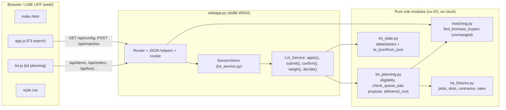
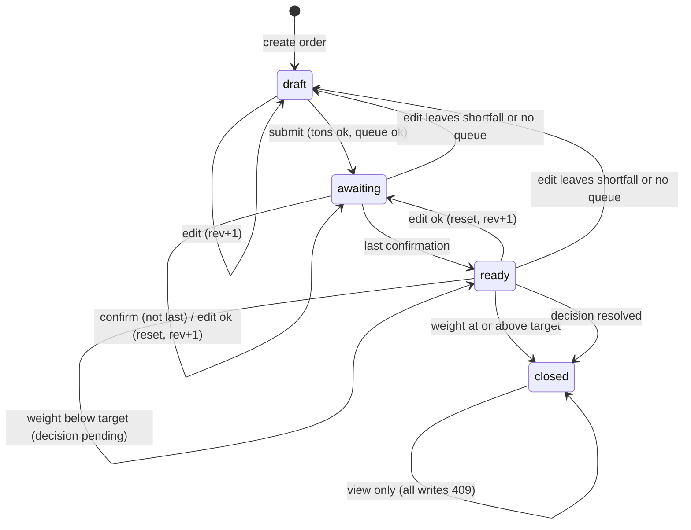

# Design Document

## Overview

This design extends the existing F3 web demo (`matching.py`, `webapp.py`, `web/`) with a rice-straw lot planning flow for a Coordinator. The F3 search keeps its behavior. The server stays on the Python standard library (`wsgiref`), needs no AWS credentials, and does not touch `agent.py` or `check_bedrock.py`.

Design goals, in priority order:

1. **Rules are pure and testable.** Screening, queue checks, proposal, and cost are pure functions over immutable data. They do no I/O, no clock reads, and no randomness (Requirement 15.7).
2. **One state machine owns every write.** All Lot changes go through one `apply` pipeline in `lot_service.py`. It validates, computes the candidate state, derives status, and bumps `revision` exactly once.
3. **One queue check function serves two audiences.** `check_queue_pair` returns an ordered list of violations. Requirements 5.7 and 8.3 use the whole list. Requirement 16.2 uses element 0 (see [Resolving the 5.7 / 8.3 / 16.2 inconsistency](#resolving-the-57--83--162-inconsistency)).
4. **Session state is a snapshot.** A Lot is a plain value. It serializes to JSON and restores unchanged (Requirement 13.7).

### Research findings that shaped the design

- **Existing code.** `find_biomass_buyers` already implements F3 with a `<= 80` check and the required three-key ordering. `webapp.py` already returns 400 for a bad body and 422 for field errors. The design reuses `BUYERS`, `MATERIALS`, `PILOT_PROVINCES`, and `MAX_DISTANCE_KM` and does not modify `matching.py`.
- **Gaps in the existing front end versus Requirements 2 and 14.** `web/app.js` does not match the requirements in these places, so the design changes them:
  - The option-load failure text is «โหลดตัวเลือกไม่สำเร็จ», but 2.5 requires «โหลดผลไม่ได้».
  - The no-result text has extra words after «ไม่พบโรงงานที่ตรงเงื่อนไข» (2.4).
  - The LIFF failure text ends «ค้นหาผ่านเว็บได้», but 14.7 requires «ใช้งานผ่านเว็บได้».
  - No request has a timeout (2.5 requires 10 s, 14.8 requires 15 s).
  - An HTTP 400 is treated as a load failure and offers retry. The design shows the Thai 400 message and no retry.
  - Entered values are not guaranteed to survive a failed request, and the previous result list is cleared only on some paths.
- **Property-based testing.** Hypothesis is the Python library of choice. It supports stateful testing through `RuleBasedStateMachine` ([Hypothesis stateful testing](https://hypothesis.readthedocs.io/en/latest/stateful.html)). It is a dev-only dependency, so the runtime dependency list is unchanged (Requirement 15.3).
- **LIFF.** The LIFF app Endpoint URL must be HTTPS ([LIFF documentation](https://developers.line.biz/en/docs/liff/)). The page must work without LIFF (Requirement 14.5), so LIFF stays an optional script loaded only when `LIFF_ID` is set.
- **Floating point.** `matching.py` stores distances as floats. The new code uses `decimal.Decimal` for tons, distances, and money, so that 80.0 versus 80.1 km and the ×1.2 target never depend on binary rounding.

### Design decisions that go beyond the requirements text

These need review. Each fills a gap the requirements leave open.

| # | Decision | Reason |
|---|----------|--------|
| D1 | Moisture readings are stored **per Lot** (`moisture_overrides`), not on the shared fixture Plot. | A Lot then holds all of its own state, which makes the 13.7 round trip and the 10.1 reset local to one Lot. |
| D2 | When a moisture reading or price change makes a selected Plot ineligible, the Plot is **dropped from the selection** in the same write, then Estimated_Tons is recomputed. | Selection must only hold eligible Plots. The drop is reported in the response. |
| D3 | Once a weight is recorded and a shortfall decision is pending, plan edits (Plots, price, queue, moisture) are rejected with **HTTP 409**. | Requirement 10.1 resets «พร้อมดำเนินงาน» on edit, but a weighed lot is past planning. Resetting would orphan the recorded weight. |
| D4 | A manual queue choice is **kept** after a Plot edit if it is still feasible. Otherwise the pair is re-proposed. | Avoids silently overriding a Coordinator choice while still keeping 7.1 (recompute) true. |
| D5 | Each Session holds at most 20 Lots, and the Session_Store holds at most 500 Sessions (oldest-idle evicted). | Bounds memory on a public demo. The cap is not in the requirements. |
| D6 | Check order within one check kind is by subject id ascending (Plot id or slot id). | Makes "element 0" deterministic. |
| D7 | A `revision` field is required on every Lot write request. | Needed for 13.6. |

## Architecture



### Module layout

Follows `structure.md` (snake_case, flat root modules because `matching.py` is already at the root).

| File | Role | Purity |
|------|------|--------|
| `matching.py` | F3 rules and buyer fixtures. **Unchanged.** | pure |
| `lot_fixtures.py` | Mock Plots, queue Slots, Contractor, cost rates (A1), capacity (A2). Synthetic names only (A10). | constants |
| `lot_state.py` | Frozen dataclasses, `Status` enum, Thai labels, `lot_to_json` / `lot_from_json`, `format_tons`. | pure |
| `lot_planning.py` | `plot_eligibility`, `check_queue_pair`, `propose_queue`, `select_plots`, `delivered_cost`, `build_view`. | pure |
| `lot_service.py` | `SessionStore`, `Session`, request validation, `apply_edit`, `submit`, `confirm`, `record_weight`, `decide_shortfall`. Takes an injected `clock`. | stateful, no I/O |
| `webapp.py` | Routes, JSON, cookie, headers. Extends the existing file. | I/O edge |
| `web/index.html`, `web/app.js`, `web/lot.js`, `web/style.css` | UI. `lot.js` is new. | browser |
| `tests/` | pytest + Hypothesis. | dev only |
| `docs/test-report.md` | Test report for Requirement 17.4–17.7. | doc |

### Time model

Requirement A3 says dates are offsets from the Session creation date. The pure modules use **integer day offsets** (`day = 0` is the Session start date), so they never read a clock. `lot_service.py` converts at the edge:

- Order delivery date: ISO `YYYY-MM-DD` in the request, converted to `delivery_day = (date - session.start_date).days`. A value below 0 is rejected (3.1).
- Contractor Confirmation dates: ISO dates, converted the same way and compared with the selected slot days (9.2, 9.3).
- Responses carry both `day` and the ISO `date`.
- `Session.start_date` and `confirmed_at` come from the injected `clock`. Tests pass a fake clock.

### Lot state machine



Status codes are English (`draft`, `awaiting_confirmation`, `ready`, `closed`). The server adds `status_label` in Thai: «ร่าง», «รอยืนยัน», «พร้อมดำเนินงาน», «ปิดล็อต». While a shortfall decision is pending, the status stays `ready` and the derived field `next_action` is `decide_shortfall`.

## Components and Interfaces

### `lot_planning.py` (pure)

```python
CHECK_ORDER = ("ready_date", "last_clearing_date", "delivery_date", "queue_capacity")

@dataclass(frozen=True)
class Violation:
    code: str            # one of CHECK_ORDER
    subject_type: str    # "plot" | "slot"
    subject_id: str
    message_th: str      # names the Plot or Slot and the violated constraint
    detail: Mapping[str, str]   # e.g. {"bale_day": "1", "ready_day": "2"}

def plot_eligibility(plot, order, moisture_override) -> Eligibility
def select_plots(eligible_plots, order) -> tuple[str, ...]
def check_queue_pair(plots, order, bale_slot, haul_slot) -> tuple[Violation, ...]
def propose_queue(plots, order, bale_slots, haul_slots) -> QueueProposal
def delivered_cost(plots, plant_id) -> DeliveredCost | None
def build_view(lot, fixtures) -> LotView
```

- `Eligibility(eligible: bool, moisture_pending: bool, reasons: tuple[Reason, ...])`. Reasons are ordered: material, distance, moisture, baling window, haul window (Req. 4.3–4.5, 4.8). `reasons` is empty exactly when `eligible` is true.
- `select_plots` sorts by `(distance_km, ready_day, plot_id)` (A7) and takes Plots until `estimated * 10 >= target * 12` (the 120% rule of A6, exact in `Decimal`) or the list ends.
- `delivered_cost` returns `None` when Estimated_Tons is 0 (Req. 6.6). Otherwise it returns `(straw + bale + haul) / tons` rounded half-up to whole baht (A13), where `straw = 300 × tons`, `bale = 250 × tons`, and `haul = Σ tons_i × distance_i × 5` (A1, 6.2).

### Plot eligibility details

| Rule | Eligible when | Req. |
|------|---------------|------|
| Material | `plot.material == order.material` | 4.1, 4.5 |
| Distance | `distance_to_plant <= 80` (so 80.0 passes, 80.1 fails) | 4.1, 4.4 |
| Moisture | `moisture is None or moisture <= order.max_moisture`. `None` sets `moisture_pending` and the UI shows «รอตรวจ». | 4.1–4.3, A9 |
| Baling window | `ready_day <= last_clear_day` | 4.6, 4.8 |
| Haul window | `ready_day <= delivery_day` (the earliest baling day is `ready_day`, and the haul day must be on or after it and on or before delivery) | 4.7, 4.8 |

Slot-level date conflicts are not part of Plot eligibility. They are queue checks (below), because they depend on which slot is chosen.

### Resolving the 5.7 / 8.3 / 16.2 inconsistency

Requirements 5.7 and 8.3 report every failing condition. Requirement 16.2 reports only the first failing condition in the order ready date, last clearing date, delivery date, queue capacity. One function satisfies both:

```python
def check_queue_pair(plots, order, bale_slot, haul_slot) -> tuple[Violation, ...]:
    """Return all violations, sorted by (CHECK_ORDER index, subject_id).
    Empty tuple means the pair is feasible. Element 0 is the 'first failing condition'."""
```

Checks, with `b = bale_slot.day`, `h = haul_slot.day`, `est = Σ expected_tons`:

1. `ready_date`: for each Plot (by id) with `b < plot.ready_day`.
2. `last_clearing_date`: for each Plot (by id) with `b > plot.last_clear_day`.
3. `delivery_date`: the haul slot (subject = haul slot id) if `h > order.delivery_day` or `h < b`.
4. `queue_capacity`: each slot (bale first, then haul, by id within kind) with `remaining_tons < est`.

Bounds are inclusive on both ends (4.6, 4.7). The tuple is sorted by `(CHECK_ORDER.index(code), subject_id)`.

- **5.7 and 8.3** return `list(violations)` in the response field `violations`.
- **16.2** reads `violations[0]`. The UI and the scenario (b) test assert on that element and on the lot staying in its prior status with no Confirmation created. The response also carries `first_violation` as a convenience copy of element 0 (or `null`).
- **Which pair is reported when no pair is feasible.** `propose_queue` scans pairs in `(bale_day, bale_slot_id, haul_day, haul_slot_id)` order. It returns the first pair with an empty tuple. If none exists, it returns the pair with the fewest violations (ties broken by the same scan order) as `best_failed_pair` together with that pair's violations, and assigns no queue (5.7). If there are no slots of a kind, it returns one `queue_capacity` violation with `subject_id = "none"`.
- **Selected-pair check at submit (8.3).** `submit` classifies each of the two slots as `missing` (no id selected) or `infeasible` (a violation names it, or a violation concerns the selected pair). It returns both the per-slot classification and the ordered violations.

### `lot_service.py`

```python
class SessionStore:
    def __init__(self, clock, token_factory=secrets.token_urlsafe, max_sessions=500)
    def resolve(self, token: str | None) -> tuple[Session, bool]   # (session, was_reset)
    def sweep(self) -> None                                         # removes sessions idle >= 24 h

class Session:  # one threading.Lock per session
    session_id: str; start_date: date; last_seen: datetime
    lots: dict[str, Lot]; lot_order: list[str]; next_seq: int
```

Operations (each returns `Result(ok, http_status, body)` and mutates the session only on success):

| Operation | Checks, in order | Effect |
|-----------|------------------|--------|
| `create_order(session, payload)` | body shape → field validation (3.1, 3.3) → plant rule (3.4) → Lot cap (D5) | New Order and Lot (`draft`, revision 0) |
| `get_lot(session, lot_id)` | lot exists (404) | Read only. Works in every status (7.10). |
| `propose(session, lot_id, rev)` | lot, revision (409), not closed (409), status `draft` (409) | Sets selection and queue from `select_plots` and `propose_queue` |
| `apply_edit(session, lot_id, rev, edit)` | lot, revision, not closed, D3 lock, edit validation (422) | See [Edit pipeline](#edit-pipeline) |
| `submit(session, lot_id, rev)` | lot, revision, status `draft` (409), tons (422), queue (422) | `awaiting_confirmation` and one pending Confirmation per party (8.4) |
| `confirm(session, lot_id, rev, party_id, dates?)` | lot, revision, party exists (404), status `awaiting_confirmation` (409), contractor dates (422) | Marks confirmed. Idempotent. Flips to `ready` on the last one. |
| `record_weight(session, lot_id, rev, value)` | lot, revision, status `ready` (409), value (422) | Stores `actual_tons`. Closes or sets a pending decision. |
| `decide_shortfall(session, lot_id, rev, choice)` | lot, revision, pending decision (409), choice valid (422) | Resolves and closes |

Check order for writes is fixed: **404 lot → 409 revision mismatch → 409 closed/status → 422 validation**. This makes 7.9 and 13.6 testable independently of body content.

#### Edit pipeline

`apply_edit` handles five edit types: `add_plot`, `remove_plot`, `set_price`, `set_moisture`, `set_queue`.

1. Validate the edit alone (eligibility for `add_plot`, price rule of 3.1 for `set_price`, 0–100 numeric for `set_moisture`, slot feasibility under 5.3 for `set_queue`). Any failure returns 422 or 409 with the field name and reason. State is untouched (10.6, 7.2, 7.6, 7.8).
2. Build a candidate Lot with the change applied.
3. **Normalize:** drop selected Plots that are now ineligible (D2), then keep the selected queue pair if `check_queue_pair` is empty (D4), otherwise call `propose_queue`.
4. If the normalized candidate equals the current Lot, return success with no change, no revision bump, and no reset notice (10.5).
5. Derive the new status from the candidate (rules below), set `revision = old + 1`, and return the full view, including `estimated_tons`, `shortfall_tons`, `delivered_cost`, and the queue result in one response (7.1, 7.7).

Status after a changing edit:

| Status before | Estimated ≥ Target and queue feasible | Result | Req. |
|---------------|---------------------------------------|--------|------|
| `draft` | either | stays `draft`, confirmations untouched | 10.4 |
| `awaiting_confirmation` or `ready` | yes | all Confirmations → pending, status `awaiting_confirmation` | 10.1 |
| `awaiting_confirmation` or `ready` | no | all Confirmations → pending, status `draft`, response lists failing conditions | 10.3 |

The response includes `reset_notice = {changed_field, reset_parties}` only when Confirmations were reset (10.2).

### HTTP API

Existing endpoints stay as they are (1.6): `GET /api/config`, `POST /api/matches`. New endpoints:

| Method and path | Body | Success | Errors |
|-----------------|------|---------|--------|
| `GET /api/demo` | none | `200` demo bootstrap: plants, preset (`target_tons: 10`), rates labeled «ประมาณการ», Lot summaries, `session_reset` flag, `today` | none |
| `POST /api/orders` | `plant_id, material, target_tons, offer_price, max_moisture_pct, delivery_date` | `201` Lot view | 400 body, 422 fields or plant |
| `GET /api/lots/{id}` | none | `200` Lot view | 404 |
| `POST /api/lots/{id}/proposal` | `revision` | `200` Lot view with proposal | 404, 409 |
| `POST /api/lots/{id}/edits` | `revision, type, ...` | `200` Lot view and optional `reset_notice` | 404, 409, 422 |
| `POST /api/lots/{id}/submit` | `revision` | `200` Lot view | 404, 409, 422 |
| `POST /api/lots/{id}/confirmations` | `revision, party_id, bale_date?, haul_date?` | `200` Lot view and `confirmed_count` / `total` | 404, 409, 422 |
| `POST /api/lots/{id}/weight` | `revision, actual_tons` | `200` Lot view | 404, 409, 422 |
| `POST /api/lots/{id}/shortfall-decision` | `revision, choice` (`plant_accepts` or `source_more`) | `200` Lot view | 404, 409, 422 |

- Every body is JSON, at most 4096 bytes, and a JSON object. Otherwise 400 with a Thai message (as in the existing `/api/matches`).
- Unknown paths return the existing 404 JSON. A known path with the wrong method returns 405 with `Allow`.
- Numeric inputs accept JSON numbers only (not strings, not booleans), parsed through `Decimal(str(x))`. NaN and infinity are rejected.
- Error body: `{"errors": {"field": "ข้อความไทย"}, "message": "..."}` for 422. Conflict errors use `{"message": "...", "code": "revision_conflict" | "lot_closed" | "wrong_status" | "no_pending_decision"}`.

### Session cookie

- `GET /api/demo` and every `/api/lots` or `/api/orders` request resolve the Session. Static files and `/api/config` and `/api/matches` do not create a Session.
- Token: `secrets.token_urlsafe(24)` (192 bits, above the 128-bit minimum in 13.1).
- Cookie: `sid=<token>; Path=/; HttpOnly; SameSite=Lax`, plus `Secure` when the request is HTTPS (`wsgi.url_scheme` or `X-Forwarded-Proto`).
- A missing, unknown, malformed, or expired token creates a new Session. If a token was sent, the response sets `session_reset: true`, and the UI shows the Thai notice and blocks input until dismissed (13.10).
- The token never carries a LINE userId and is never derived from one (13.9).
- Expiry is checked on every resolve and by `sweep()`. A Session whose idle time is 24 h or more is removed (13.8).
- Sessions are held in memory under one store lock. Each Session has its own lock for writes, so two Sessions never share mutable data (13.2, 13.4).

### Response headers

Existing `Referrer-Policy: no-referrer` stays. Add `X-Content-Type-Options: nosniff` and a `Content-Security-Policy` that allows `script-src 'self' https://static.line-scdn.net`, `connect-src 'self' https:` (LIFF needs LINE hosts), and `style-src 'self'`. This is defense in depth for 14.10. The primary control is that the UI uses `textContent` only.

### Front end

`index.html` gets two tabs: «ค้นหาโรงงาน» (the existing F3 form) and «วางแผนล็อต». `app.js` keeps its F3 logic with the fixes listed under research findings. `lot.js` is new and has no framework.

- **Rendering.** All server text goes in with `textContent` or `Text` nodes. No `innerHTML` (14.10).
- **One screen, one primary action.** The lot screen shows the status badge and exactly one primary button, taken from the server field `next_action` (`propose`, `submit`, `wait_for_confirmations`, `record_weight`, `decide_shortfall`, `new_order`). The details (Plots, queue, cost) sit below the fold or in `<details>` so the badge and primary action fit in a 360×640 viewport (14.3).
- **Separate figures.** «ราคาที่โรงงานเสนอ» and «ต้นทุนส่งถึงโรงงาน (ประมาณการ)» are in different elements. No profit, margin, or income figure appears anywhere (3.6, 6.4, 6.5).
- **Confirmations.** Each is labeled «บันทึกโดยผู้ประสานงาน». No text implies a message was sent (9.8).
- **Failure handling.** Every `fetch` uses `AbortController` with a timeout (search: 10 s per 2.5. Lot writes and reads: 15 s per 14.8). On timeout, network error, or 5xx, the page keeps all form values, shows the failure message and a retry control, and the retry resends the retained payload. For search, a retry that succeeds shows results without a page reload (16.7).
- **LIFF.** If `liff_id` is set, load the SDK with a 10 s timeout. On failure, show «เชื่อมต่อ LINE ไม่สำเร็จ คุณยังใช้งานผ่านเว็บได้» and keep everything usable (14.7).
- **Mobile.** Buttons and inputs have `min-height: 44px; min-width: 44px` (14.4). Layout uses a single column with `max-width: 100%` and `overflow-wrap: anywhere`, so `scrollWidth` does not exceed the viewport at 360–430 px (14.2).
- **Number display.** `format_tons` (server) and an equivalent JS formatter drop trailing zeros. The summary line is built from three separate labeled values: «ออเดอร์ 10 ตัน · ประมาณการ 12 ตัน · รับจริง 10.4 ตัน» (11.6, 11.7).
- **Mock labels.** Cost figures, queue slots, and distances carry «ประมาณการ» or «ข้อมูลจำลอง» next to the number (14.9).

## Data Models

All tons, distances, prices, and moisture values are `Decimal`. Days are `int` offsets.

```python
class Status(StrEnum):
    DRAFT = "draft"; AWAITING = "awaiting_confirmation"; READY = "ready"; CLOSED = "closed"

@dataclass(frozen=True)
class Plot:                       # fixture, shared and immutable
    plot_id: str; owner_id: str; owner_name: str; material: str
    expected_tons: Decimal
    distance_km_by_plant: Mapping[str, Decimal]   # A4: mock value per (plot, plant)
    ready_day: int; last_clear_day: int
    moisture_pct: Decimal | None                  # None = unknown (A9)

@dataclass(frozen=True)
class Slot:                       # fixture (A2)
    slot_id: str; kind: str       # "bale" | "haul"
    day: int; capacity_tons: Decimal; booked_tons: Decimal   # remaining = capacity - booked

@dataclass(frozen=True)
class Order:
    order_id: str; plant_id: str; material: str       # always "ฟางข้าว"
    target_tons: Decimal; offer_price: Decimal        # baht per ton
    max_moisture_pct: Decimal; delivery_day: int

@dataclass(frozen=True)
class Confirmation:
    party_id: str; role: str      # "plant" | "farmer" | "contractor"
    name: str; confirmed: bool; confirmed_at: str | None   # ISO timestamp from injected clock
    baling_day: int | None; haul_day: int | None           # contractor only

@dataclass(frozen=True)
class ShortfallDecision:
    shortfall_tons: Decimal
    state: str                    # "pending" | "resolved"
    resolution: str | None        # "plant_accepts" | "source_more"
    remaining_to_source_tons: Decimal | None

@dataclass(frozen=True)
class Lot:
    lot_id: str; order: Order; status: Status; revision: int
    selected_plot_ids: tuple[str, ...]            # selection order, kept stable
    bale_slot_id: str | None; haul_slot_id: str | None
    moisture_overrides: Mapping[str, Decimal]     # D1
    confirmations: tuple[Confirmation, ...]
    actual_tons: Decimal | None
    shortfall: ShortfallDecision | None
```

Derived, never stored (`LotView` from `build_view`): `estimated_tons`, `shortfall_tons`, `delivered_cost` (or `None`), per-Plot eligibility and reasons, excluded-Plot list, queue result and violations, `confirmed_count` / `total`, `status_label`, `next_action`, and Thai conditions list for the order (3.2).

Constants (single place, `lot_fixtures.py`, A1/A2):

```python
STRAW_PRICE_PER_TON = Decimal(300)
BALING_PER_TON      = Decimal(250)
HAUL_PER_TON_KM     = Decimal(5)
SLOT_CAPACITY_TONS  = Decimal(15)
BUFFER_PERCENT      = 120            # A6
DEFAULT_MAX_MOISTURE = Decimal(20)   # A5
```

### Fixtures (mock, A10)

- **Plants for orders (A12):** the `BUYERS` entries that accept «ฟางข้าว» and are open: `B01`, `B02`, `B03`. `B06` is closed and is rejected (3.4).
- **Plots (standard mock data for scenario (a)):** three eligible Plots with expected tons 4, 3, 5 and distances ordered so A7 selects them first, one of which has unknown moisture (A9), plus an extra eligible 2-ton Plot that the 120% rule leaves unselected (so `add_plot` has something to add), and excluded Plots for each reason: moisture above 20%, distance above 80 km, a non-rice material, and a ready day later than the last clearing day. Exact ids and values are fixed during implementation and asserted in the scenario tests.
- **Slots:** bale slots on days 2, 3, 4 and haul slots on days 4, 5, 6 with 15 t capacity. At least one slot has booked tons that leave less than 12 t remaining, so capacity violations are reachable. All names are synthetic. No real phone numbers, LINE ids, or coordinates (16.9).
- **Contractor:** one mock Contractor with id `C01`.

### Serialization

`lot_to_json(lot) -> str` and `lot_from_json(str) -> Lot`:

- `Decimal` is written as a string (exact). `None` is `null`. Tuples are lists. Mappings are written with sorted keys.
- `lot_from_json` validates types and raises `ValueError` on malformed input. Sessions are only ever restored from data the server wrote, so this guards against programming errors, not user input.
- The API itself sends numbers (`float(d)` is exact for values with at most 2 decimals).

### Confirmation parties (A14, 8.4)

On `submit`, parties are built as: the Plant, one Farmer per distinct `owner_id` among selected Plots (sorted by owner id), and the Contractor. `total = len(parties)`. Parties are rebuilt from scratch on every submit, so exactly one Confirmation exists per party.

### Tons formatting

`format_tons(d)` quantizes to at most 2 decimals, then removes trailing zeros and a trailing decimal point (`10.40` → `10.4`, `12.00` → `12`). The summary string of 11.6 is assembled from three `format_tons` calls.

## Correctness Properties

*A property is a characteristic or behavior that should hold true across all valid executions of a system-essentially, a formal statement about what the system should do. Properties serve as the bridge between human-readable specifications and machine-verifiable correctness guarantees.*

The reflection step merged these overlapping criteria:

- 4.2–4.5 and 4.10 are folded into the eligibility property (Property 4).
- 6.2 is folded into the cost property (Property 7).
- 7.2, 7.6, 7.8, 7.9, 4.11, 9.9, 10.6, and 13.6 share one "rejected write leaves the Lot unchanged" property (Property 9).
- 9.1, 9.4–9.6, 10.3, 10.4, 11.2, 12.2, 13.3, and 13.5 are checked together by the stateful lifecycle property (Property 12).
- 11.1, 11.3–11.5, and 12.1 are one weight-outcome property (Property 17).

Criteria classified as EXAMPLE, SMOKE, or INTEGRATION in the prework (UI rendering, layout, LIFF, README, scenarios 16.1–16.7) have no property. They use the example and browser tests in the Testing Strategy.

### Property 1: Search results match the eligibility model and ordering

*For any* material, quantity, province, and buyer table (including distances of exactly 80.0 and 80.1 km), `find_biomass_buyers` returns exactly the buyers that are open, accept the material, have a minimum quantity not above the quantity, and have a distance of 80 km or less for the province. The list is sorted by price descending, then distance ascending, then buyer id ascending. Calling it twice with the same input returns equal results.

**Validates: Requirements 1.1, 1.2, 1.3, 1.5**

### Property 2: Invalid search input yields one error per invalid field

*For any* request body whose material, quantity, or province is invalid, `POST /api/matches` returns HTTP 422. The `errors` keys are exactly the invalid fields, each with a non-empty Thai message, and no `matches` key.

**Validates: Requirements 2.1**

### Property 3: Order creation is all-or-nothing

*For any* order payload, if every field is valid, the Session gains exactly one Order and one linked Lot with status `draft` and revision 0. Otherwise the response is 422 with exactly the invalid fields named (an unknown, closed, or non-straw Plant counts as an invalid `plant_id`) and the Session's serialized state is unchanged.

**Validates: Requirements 3.1, 3.3, 3.4**

### Property 4: Plot eligibility follows the rules

*For any* Plot, Order, and optional moisture override, `plot_eligibility` is eligible exactly when the material matches, the distance is 80 km or less, the moisture is unknown or at most the maximum, `ready_day <= last_clear_day`, and `ready_day <= delivery_day`. Unknown moisture sets `moisture_pending`. Ineligible results carry a non-empty reason list. Each reason contains the numbers or names it cites (measured and allowed moisture, distance and 80, both materials, or the window name). After a moisture reading in 0–100 is recorded, eligibility equals a fresh evaluation with that value.

**Validates: Requirements 4.1, 4.2, 4.3, 4.4, 4.5, 4.8, 4.10**

### Property 5: The queue check returns ordered violations and matches the constraints

*For any* set of Plots, Order, and pair of slots, `check_queue_pair` returns an empty tuple exactly when every Plot has `ready_day <= bale_day <= last_clear_day`, `bale_day <= haul_day <= delivery_day`, and both slots have remaining capacity of at least Estimated_Tons (bounds inclusive). The result is sorted by `(CHECK_ORDER index, subject id)`. Element 0 is the first violated condition in the order ready date, last clearing date, delivery date, queue capacity. The set of codes in the tuple equals the set of violated constraints.

**Validates: Requirements 4.6, 4.7, 5.3, 5.7, 8.3, 16.2**

### Property 6: Proposals select by rule and are deterministic

*For any* eligible Plot set and Order, `select_plots` returns a prefix of the Plots sorted by `(distance, ready_day, plot_id)`. The prefix stops as soon as Estimated_Tons is at least 120% of Target_Tons, or it holds every eligible Plot. The reported shortfall is `max(0, Target_Tons − Estimated_Tons)`. With no eligible Plot, the selection is empty, the shortfall equals Target_Tons, and no queue is assigned. When a queue is assigned, `check_queue_pair` on it is empty. When no queue is assigned, no pair in the slot lists is feasible. Proposing twice on the same input returns equal results.

**Validates: Requirements 5.1, 5.3, 5.6, 5.7, 5.8, 5.9, 7.3, 15.7**

### Property 7: Delivered cost matches the formula and its lower bound

*For any* non-empty selection of Plots, `delivered_cost` equals `round_half_up((300·T + 250·T + Σ tonsᵢ·distanceᵢ·5) / T)` with `T = Σ tonsᵢ`, and is at least 550. For an empty selection (T = 0), it returns `None` and does not raise.

**Validates: Requirements 6.1, 6.2, 6.6, 6.7**

### Property 8: Adding then removing a Plot restores the derived values

*For any* Lot in `draft` and any eligible Plot not yet selected, applying `add_plot` and then `remove_plot` for that Plot returns a Lot whose `selected_plot_ids`, Estimated_Tons, shortfall, and Delivered_Cost equal the originals. After each step, the returned view equals `build_view` of the stored Lot.

**Validates: Requirements 6.3, 7.1**

### Property 9: A rejected write leaves the Lot unchanged

*For any* Lot and any write request that is rejected (a wrong `revision`, a closed Lot, an excluded Plot, an infeasible slot, an invalid price, a moisture value outside 0–100 or non-numeric, an unknown party, or an unknown Lot), the Lot's serialized form and revision are equal before and after. The response status is 409 for a revision, status, or closed conflict, 404 for an unknown Lot or party, and 422 for invalid values. Reads of a closed Lot still succeed.

**Validates: Requirements 4.11, 7.2, 7.6, 7.8, 7.9, 9.9, 10.6, 13.6**

### Property 10: A queue choice is accepted exactly when it is feasible

*For any* Lot in `draft` and any pair of slot ids from the fixture, `set_queue` succeeds exactly when `check_queue_pair` for the current selection and that pair is empty. On success, the Lot holds that pair. On failure, the previous pair is unchanged and the response carries the ordered violations.

**Validates: Requirements 7.5, 7.6**

### Property 11: Repeating an edit is a no-op

*For any* valid edit applied to a Lot, applying the same edit again returns success with an equal Lot, unchanged revision, unchanged Confirmations, and no `reset_notice`.

**Validates: Requirements 10.5**

### Property 12: Lifecycle invariants hold across arbitrary operation sequences

*For any* sequence of operations (propose, edit, submit, confirm, weigh, decide) applied to a fresh Lot, after every operation: (a) the revision grows by exactly 1 if the operation was accepted and changed a value, and by 0 otherwise; (b) `ready` implies every Confirmation is confirmed, Estimated_Tons ≥ Target_Tons, and the queue is feasible; (c) `awaiting_confirmation` implies at least one Confirmation is pending, Estimated_Tons ≥ Target_Tons, and the queue is feasible; (d) `draft` implies no Confirmation is confirmed; (e) `closed` implies a weight is recorded and either it is at least Target_Tons or the shortfall decision is resolved; (f) `confirmed_count / total` equals the real count; (g) an operation not defined for the current status is rejected with 409 and changes nothing; (h) `GET` returns a Lot equal to the one in the last response.

**Validates: Requirements 8.1, 8.2, 8.3, 8.5, 9.1, 9.4, 9.5, 9.6, 10.1, 10.3, 10.4, 11.2, 12.2, 13.3, 13.5**

### Property 13: Submit creates exactly one Confirmation per required party

*For any* submittable Lot, after `submit` the Confirmation party ids are exactly the Plant, one Farmer per distinct owner of the selected Plots, and the Contractor, with no duplicates and all pending. Submitting again after an edit that returns to `draft` rebuilds the set from the new selection.

**Validates: Requirements 8.4**

### Property 14: Recording a Confirmation twice changes nothing

*For any* Lot in `awaiting_confirmation` and any of its parties, recording that party's Confirmation twice leaves the Lot equal to the state after the first recording, including the original `confirmed_at`. The second call returns success.

**Validates: Requirements 9.7**

### Property 15: Contractor dates must equal the selected slots

*For any* Lot in `awaiting_confirmation` and any `bale_date` and `haul_date` (valid dates, invalid text, or missing), the Contractor Confirmation is recorded exactly when both dates equal the selected slot dates. Otherwise the response is 422 and states that the queue must be edited first, and the Lot is unchanged.

**Validates: Requirements 9.2, 9.3**

### Property 16: An accepted edit after confirmation resets all parties

*For any* Lot in `awaiting_confirmation` or `ready` and any accepted edit that changes a value, every Confirmation becomes pending and the revision grows by exactly 1. The status is `awaiting_confirmation` if Estimated_Tons ≥ Target_Tons and the queue is feasible, otherwise `draft` with each failing condition returned. The `reset_notice` names the changed field and every party that was reset.

**Validates: Requirements 10.1, 10.2, 10.3**

### Property 17: Weight outcome depends only on status and value

*For any* Lot and any submitted `actual_tons` (any JSON value), the weight is accepted exactly when the Lot is `ready` and the value is a finite number greater than 0 and at most 100. The stored value is the input rounded half-up to 2 decimals. If the stored value is at least Target_Tons, the Lot becomes `closed`. If it is below, the status stays `ready`, the shortfall is `Target_Tons − stored` (2 decimals), and the decision is pending. A later accepted value replaces it. A wrong status gives 409 and an invalid value gives 422, both with the Lot unchanged.

**Validates: Requirements 11.1, 11.3, 11.4, 11.5, 12.1, 12.2**

### Property 18: Shortfall decisions resolve and close the Lot

*For any* Lot with a pending shortfall decision, `plant_accepts` closes the Lot with 0 tons to source, and `source_more` closes the Lot with remaining tons equal to the shortfall. For any Lot without a pending decision, any choice gives 409 and changes nothing.

**Validates: Requirements 12.4, 12.5, 12.6**

### Property 19: Tons formatting is exact and has no trailing zeros

*For any* Decimal with at most 2 decimal places, `format_tons` output parses back to an equal value and contains no trailing zero after a decimal point and no trailing decimal point. The shortfall text «ขาด X ตัน» uses `format_tons` of a value equal to Target_Tons minus Estimated_Tons.

**Validates: Requirements 7.3, 11.7**

### Property 20: Sessions are isolated

*For any* two Sessions and any interleaved sequence of operations, an operation on one Session never changes the other Session's serialized state. A token that is unknown, malformed, or expired never resolves to an existing Session.

**Validates: Requirements 13.2, 13.4, 13.10**

### Property 21: Lot serialization round trip

*For any* valid Lot state (any status, selection, overrides, Confirmations, weight, and shortfall), `lot_from_json(lot_to_json(lot))` equals the Lot, and serializing again yields the same string.

**Validates: Requirements 12.7, 13.7**

### Property 22: Idle Sessions expire at 24 hours

*For any* idle duration and injected clock, a Session is removed by `sweep()` or by the next `resolve` exactly when its idle time is 24 hours or more. A Session idle for less than 24 hours is kept with its Lots intact.

**Validates: Requirements 13.8**

## Error Handling

| Situation | Status | Body | State change | Req. |
|-----------|--------|------|--------------|------|
| Body missing, over 4096 bytes, invalid JSON, or not an object | 400 | `{"message": "ข้อมูลไม่ถูกต้อง"}` (search keeps its current text) | none | 2.2 |
| Invalid field values (search, order, moisture, price, weight, dates) | 422 | `{"errors": {...}, "message": ...}`, all invalid fields in one response | none | 2.1, 3.3, 4.11, 11.3 |
| Wrong `revision` | 409 | `code: revision_conflict`, Thai text that another edit changed the Lot | none | 13.6 |
| Lot closed | 409 | `code: lot_closed` | none | 7.9 |
| Operation not allowed in this status | 409 | `code: wrong_status` | none | 8.5, 9.6, 11.2 |
| Plan edit while a shortfall decision is pending (D3) | 409 | `code: weighed_lot_locked` | none | D3 |
| Choice without a pending decision | 409 | `code: no_pending_decision` | none | 12.6 |
| Unknown Lot or party | 404 | `{"message": ...}` | none | 9.9 |
| Submit with shortfall or bad queue | 422 | shortfall tons, per-slot `missing` / `infeasible`, ordered `violations` | none | 8.2, 8.3 |
| Contractor dates differ from slots | 422 | states the queue must be edited first | none | 9.3 |
| Unknown path / known path with wrong method | 404 / 405 | JSON message | none | existing |
| Lot cap or Session cap reached (D5) | 422 for Lots, oldest Session evicted | `code: lot_limit` | none | D5 |
| Unexpected exception | 500 | generic Thai message, no stack trace, no echo of request data | none (writes run on a copy and commit by one assignment) | safe default |

- **Atomic writes.** Every write builds a candidate Lot, validates it, and commits it with a single assignment under the Session lock. A failure at any step leaves the stored Lot untouched.
- **Check order** is 404 → 409 revision → 409 status → 422 values, so error codes are predictable.
- **Browser failures.** A timeout, network error, or 5xx keeps all entered values, shows the Thai failure text and a retry control, and removes stale results where Requirement 2.5 asks (search). A 4xx shows its own Thai message and no retry.
- **Session reset.** An invalid or expired token produces a fresh Session and `session_reset: true`. The UI shows the notice and blocks input until dismissed (13.10).
- **LIFF failure.** Shows «เชื่อมต่อ LINE ไม่สำเร็จ คุณยังใช้งานผ่านเว็บได้» and nothing else changes (14.7).
- **Privacy.** Logs record method, path, status, and duration only. They never log request bodies or tokens.
- **Misuse limits.** Payloads are capped at 4096 bytes. Numeric inputs are capped (tons ≤ 100, price ≤ 100,000, moisture 0–100). The Session and Lot caps in D5 bound memory.

## Testing Strategy

### Approach

Property-based testing applies here because the core is pure business logic with a large input space: eligibility, queue checks, proposal, cost, a state machine, and serialization. It does not apply to HTML, CSS, LIFF, deployment, or the README. Those use example tests, browser checks, and review.

| Layer | Method | Tool |
|-------|--------|------|
| `matching.py`, `lot_planning.py`, `lot_state.py`, `lot_service.py` | Property-based tests (Properties 1–22) plus example tests for fixtures and scenarios | pytest + Hypothesis |
| Lifecycle (Property 12) | Hypothesis `RuleBasedStateMachine` with operations as rules and invariants as checks | Hypothesis |
| HTTP layer (`webapp.py`) | Example tests that call `application(environ, start_response)` directly, with no socket and no network | pytest |
| UI (2.3–2.7, 3.5, 3.6, 4.9, 5.4, 5.5, 6.4, 6.5, 9.8, 11.8, 12.3, 14.2–14.10, 16.1, 16.7) | Browser checks at 360×640 and 430 px width | Playwright (dev-only, optional) |
| Deployment and LIFF in LINE | Manual, reported honestly | `docs/test-report.md` |

### Property test configuration

- Library: **Hypothesis**, added to a dev-only dependency group in `pyproject.toml` (with `pytest`), so the runtime dependency list (`strands-agents`) is unchanged. `uv.lock` is regenerated with `uv lock`. Run with `uv run --locked pytest -q`.
- Each property is **one** Hypothesis test with `@settings(max_examples=100)` or higher (the stateful test uses `max_examples=100` and `stateful_step_count=30`).
- Each test carries a comment in the form `# Feature: straw-lot-planning-demo, Property N: <title>`.
- Generators live in `tests/strategies.py`: Decimals with 0–2 places, distances clustered around 80, day offsets, Plots, Orders, slots, Lots in each status, and invalid-value generators (booleans, strings, NaN, infinity, huge ints, out-of-range numbers).
- A fake clock fixture drives `confirmed_at`, `start_date`, and Session expiry. No test reads the real clock or the network.
- Fixtures use only synthetic names and ids (16.9). A test scans `lot_fixtures.py` for digit runs shaped like phone numbers and for the prefixes of LINE ids.

### Example and scenario tests

- **Scenario (a)** (16.1): preset order of 10 t → proposal selects 4, 3, 5 t (12 t) → submit → five Confirmations (Plant, three Farmers, Contractor) → `ready` → weight 10.4 → `closed` with the exact string «ออเดอร์ 10 ตัน · ประมาณการ 12 ตัน · รับจริง 10.4 ตัน». Run at API level always. Run in the browser at 360×640 when Playwright is available.
- **Scenario (b)** (16.2, 16.3): a Plot cleared before every baling slot, and a slot that cannot meet delivery. Assert `violations[0]` names the right Plot or slot and the right code. Assert submit is rejected, the status is unchanged, and no Confirmation exists. Also assert exactly one missing Confirmation is listed by name and the Lot stays `awaiting_confirmation`.
- **Scenario (b/c)** (16.4–16.6): edit a Plot after all Confirmations → back to `awaiting_confirmation` with all pending. Weight below target → shortfall and both options. F3 search results (16.6) and retry after an aborted request (16.7).
- **Existing F3 contract** (1.6): examples for `GET /api/config` and `POST /api/matches`.
- **Fixture facts:** the preset yields 4, 3, 5 t; `B06` is rejected; the 80.0/80.1 km pair.
- **Security checks:** markup in a mock owner name renders literally (14.10); the cookie has `HttpOnly`, `SameSite=Lax`; the token decodes to at least 16 bytes (13.1); no route sends a LINE message, payment, or carbon claim (15.6); `agent.py` and `check_bedrock.py` have no diff (15.4).
- **Smoke:** the app starts with no AWS credentials and no network, and runtime modules import only the standard library (15.1, 15.3).

### Test report

`docs/test-report.md` lists each command run, passed/failed/skipped counts, run date, and up to 20 lines of output per command (17.4). It has three headings: **Verified results**, **Assumptions**, **Untested items** (17.6). Any failed test is listed by name with a failure summary (17.7). If no HTTPS endpoint or `LIFF_ID` exists, the report states that testing stopped at local HTTP and browser or viewport checks, and that the page was not opened inside LINE (17.5).

### Build order for the tasks phase

1. `lot_state.py`, `lot_fixtures.py`, `format_tons`, serialization (Properties 19, 21).
2. `lot_planning.py` (Properties 4–7).
3. `lot_service.py` and `SessionStore` (Properties 3, 8–18, 20, 22).
4. `webapp.py` routes, cookie, headers (HTTP example tests).
5. Front end: fix `app.js` gaps, add `lot.js`, tabs, styles.
6. README, deployment steps, test report.
